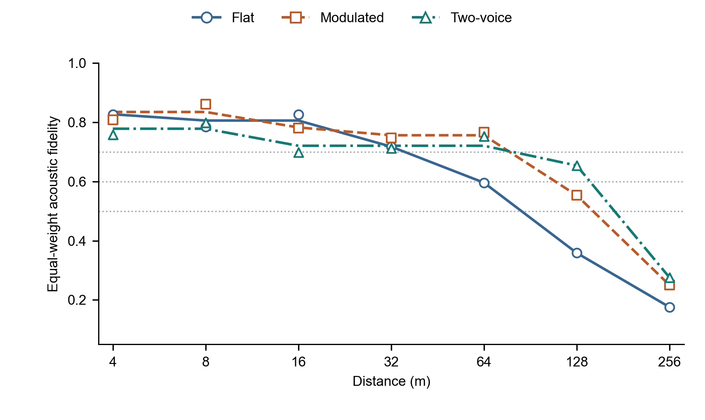
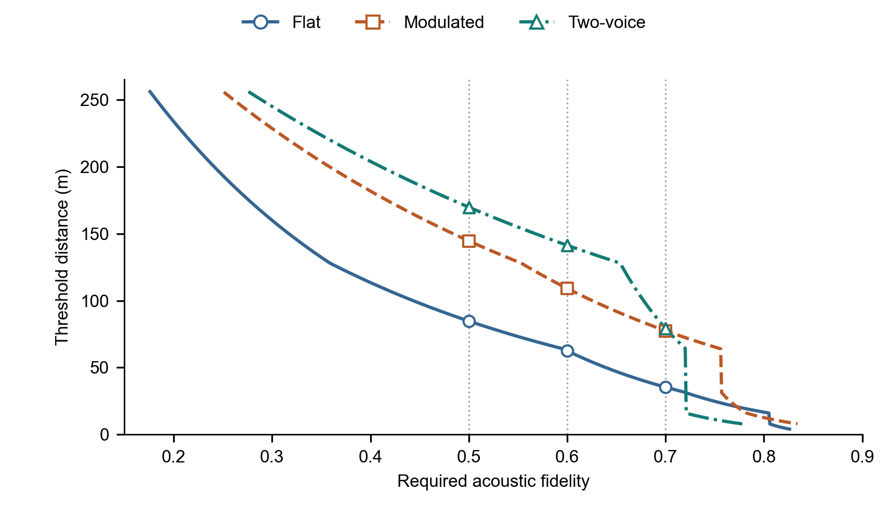
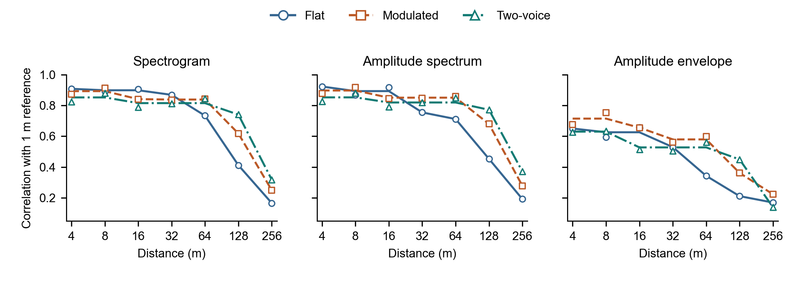
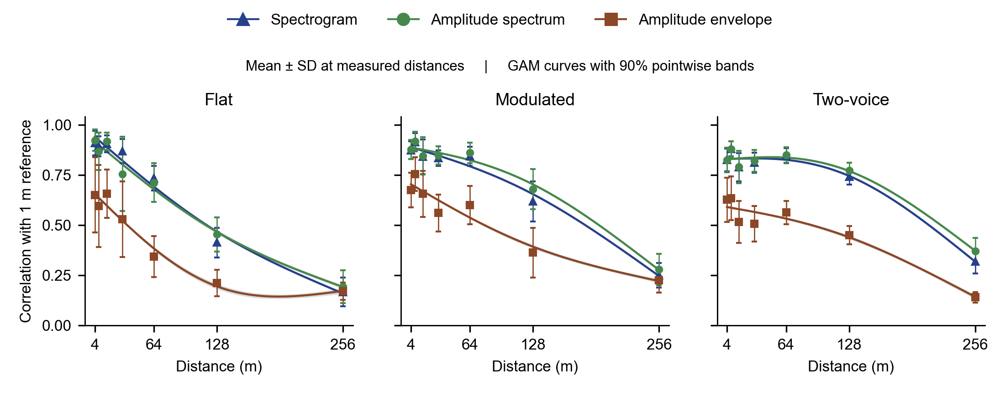
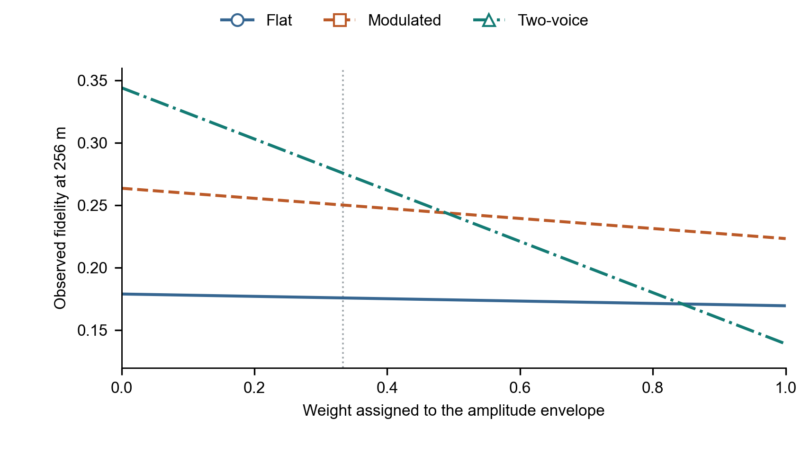

# 第二问　传播保真度与有效通信距离

三种叫声在平静水面上方传播时，平直型最早失去结构相似性。以三项声学线索等权、平均保真度达到 0.5 为准，平直型、调制型和双声型的估计距离依次为 **85、145、170 m**。提高要求至 0.7 后，调制型与双声型分别为 **78、79 m**。双声型的远距优势主要来自频谱结构。若任务更依赖振幅随时间的起伏，调制型可以领先。

## 距离估计与实测依据

括号表示主曲线交点所在的**相邻实测距离档**，单位均为 m。表中小数是档间插值结果。阈值为操作性识别标准，未经企鹅听觉试验校准。

| 叫声 | 潜在识别，0.5 | 一般识别，0.6 | 可靠识别，0.7 | 原始均值从近到远连续达到 0.7 的最远测点 |
|---|---:|---:|---:|---:|
| 平直型 flat | 84.7（64–128） | 62.6（32–64） | 35.4（32–64） | 32 |
| 调制型 mod | 144.6（128–256） | 109.1（64–128） | 77.5（64–128） | 64 |
| 双声型 tv | 169.7（128–256） | 141.3（128–256） | 79.3（64–128） | 8 |

**为什么双声型有两个看似矛盾的数字？** 它在 16 m 的原始三通道综合均值为 0.6979，略低于 0.7，随后在 32、64 m 回升至 0.7119、0.7521。保序拟合让 16–64 m 的趋势处于约 0.7206 的平台，随后在 79.3 m 穿过阈值。若要求近处起每个实测点都达标，第一次失守发生在 16 m，前一档为 8 m。两种口径回答不同问题。图中空心点表示原始均值，线表示拟合趋势。

阈值在 0–1 上以 0.001 的步长输出；任意中间阈值也可以直接求交点。图中仅绘制 4–256 m 范围内能定位交点的部分。曲线陡降处对应保序平台：识别要求一旦超过平台高度，连续达标距离会明显缩短。原始数据没有这么密的距离测点。

## 数据与模型

- Data03–11 共有 18,900 个相关系数位置，17,550 个有效、1,350 个缺失，有效值范围为 0.051–0.995。保留 NA，分别计算 63 个“叫声 × 通道 × 距离”单元的均值、中位数、标准差和四分位数。每类有三个源样例，每个样例的 1 m 参考录音与远端录音重复配对；同一录音可进入多个系数。原表缺少可验证的样例与两端录音编号，故只在距离均值层面融合。[实验设计与传播条件](https://ore.eu/article/view/1538/version/2510)
- 每项通道独立最小化七个距离均值到一条不升趋势的平方误差，七档等权。档间在对数距离上作线性插值。声谱图、幅度谱、包络分别度量时频图案、频率强弱分布和振幅节律。三项均值等权形成主保真度，再求首次向下越过阈值的距离。1 m 只用作参照。
- 物理对照取 \(\mu_{cm}(d)=a_{cm}/\sqrt{1+(d/L_{cg})^2}\)，隐含功率平方反比扩散和近似稳定背景噪声。每类的声谱图与幅度谱共享有效长度 \(L\)，包络单独估计 \(L\)，各通道分别估计近场上限 \(a\)。平直、调制、双声三类的频谱组／包络有效长度约为 69／45、114／86、155／109 m。\(L\) 对应该通道降至自身上限的 \(1/\sqrt{2}\)，不能直接当作识别半径。相关性模型不能把剩余损失唯一分解成反射、吸收或噪声。

## Supplementary 4 的复核

按原图将平直型、调制型、双声型自左至右排列，横轴为水面上方的实际传播距离。蓝色三角表示声谱图、绿色圆点表示幅度谱、棕色方块表示包络。每个点及误差棒对应一个距离档的均值和样本标准差。线是用全部有效相关系数拟合的 GAM，灰带表示该曲线均值的逐点 90% 置信区间。通信距离的删距范围另见下文。[原始图及图注](../题目与要求/date/Supplementary4_Signal_degradation_estimation.pdf) · [附件 Code2](../题目与要求/date/Code2_AfricanPenguins_signal_degradation.R)

Python 按文件编号整理原始宽表，R 另按文件名中的叫声和声学指标定位数据。拟合之前核对全部 18,900 个位置的行号、距离、相关值和缺失位置，并核对 63 组有效数、均值和样本标准差。本次另跑 Code2 中生成 Supplementary 4 的数据整理语句，用得到的九组原始观测重新拟合 GAM。在同一 R 环境下，两条路径算出的均值、标准差、GAM 点预测和逐点区间端点的最大绝对差均小于 10⁻¹²。留出距离的预测表现见下一节。[逐组数值核对表](results/supplementary4_check.csv)

| 叫声 | 0.5 主模型 / GAM（m） | 0.7 主模型 / GAM（m） |
|---|---:|---:|
| 平直型 | 84.7 / 86.9 | 35.4 / 35.5 |
| 调制型 | 144.6 / 162.1 | 77.5 / 73.0 |
| 双声型 | 169.7 / 188.0 | 79.3 / 97.2 |

例如在 0.5 下，GAM 对双声型给出的距离比主模型远约 18 m，但两者均把双声型排在首位。提高到 0.7 后，主模型中双声型与调制型相差约 2 m，GAM 中相差约 24 m。表中的距离由团队将各模型的三项预测等权融合后求交点得到。[各模型阈值交点](results/model_thresholds.csv)

## 留出距离检验

依次留出 8、16、32、64、128 m 的完整距离档，从其余六档预测三类叫声的三项通道均值，每种模型有 45 个预测。4 m 与 256 m 不混入内插误差。GAM 实际使用 R 4.4.3 和 mgcv 1.9-1，按附件 Code2 的米制距离拟合各通道全部有效相关值，采用 \(\texttt{s(d,k=3)}\) 与 REML。评分均以相同的留出单元均值为准。

| 模型 | 留距 RMSE | 留距 MAE | 0.7 距离，flat / mod / tv（m） |
|---|---:|---:|---|
| 保序＋对数距离插值，预定主模型 | 0.0751 | 0.0623 | 35.4 / 77.5 / 79.3 |
| 保序＋米制距离插值 | 0.0632 | 0.0546 | 36.6 / 81.7 / 83.8 |
| 几何扩散和有效噪声 | 0.0693 | 0.0597 | 37.8 / 64.9 / 61.7 |
| 原作者形式的 GAM | **0.0584** | **0.0516** | 35.5 / 73.0 / 97.2 |

按预定方案保留局部可解释的保序估计，五个内部距离的总体预测误差以 GAM 最低。四种模型在 0.5 下均给出“双声型 > 调制型 > 平直型”。在 0.7 下，物理模型里调制型领先，GAM 里双声型领先约 24 m，保序主模型中两者相差不足 2 m。因此可靠识别标准下，平直型较短的结论更稳健；另外两类的差距和排序依赖模型选择。

## 不确定性、缺失与权重

| 叫声 | 0.5 删一距离估计范围（m） | 0.7 删一距离估计范围（m） |
|---|---:|---:|
| 平直型 | 74.2–87.9 | 32.2–35.4 |
| 调制型 | 129.1–144.6；另 1 次只能确定 ≥128 | 44.7–79.0 |
| 双声型 | 127.3–169.7；另 1 次只能确定 ≥128 | 35.1–85.0 |

每次删去一个距离并重做九条曲线。调制型和双声型在删去 256 m 时，剩余测点到 128 m 仍达到 0.5，这一折只能报告单侧界限。上表是测点敏感性范围。将同一录音产生的相关系数逐行重抽会制造虚假的样本量，故本次未给传播距离冠以“95% 置信区间”。

**缺失观测会怎样影响排名？** 若假设每个缺失系数等于同单元有效观测的下四分位数，三类的 0.5 距离分别为 81.7、138.4、166.8 m。若在压力测试中把所有缺失系数都视作零，距离变为 63.3、109.2、102.6 m，调制型反超双声型。双声型在 128 m 仅有 190/300 个有效系数，因此“潜在识别传得最远”有赖于被剔除的录音没有系统性地弱到该极端情景。两种假设均独立于主分析，原表 NA 保留。

**传播得更远的是哪条线索？** 在 256 m，双声型、调制型的声谱图相关性分别为 0.318、0.249，幅度谱为 0.371、0.278，包络为 0.139、0.223。令包络占 \(w\)，两个谱指标各占 \((1-w)/2\)，直接由该测点均值解得两类排序在 **\(w=0.4885\)** 处互换。在 \(w=0.5\) 下，0.7 阈值处主模型的调制型距离约 66.6 m，双声型约 12.1 m。双声型近距离的平台靠近该阈值，权重变化能使整个平台跌破门槛。256 m 三类均已低于 0.5，权重交点描述的是剩余线索的质量。

## 海上回放核对

Data02 按日期和实验编号得到 139 对自然叫声与对照。自然声有 90 次出现至少一项反应，对照为 18 次，两者的样本响应率为 64.7% 和 12.9%。配对实验中有 90 对的播放距离不同，2 对的观测群体数量不同。分析只对自然叫声匹配保真度，保留两次播放各自的协变量。

以每对实验的自然声响应指示减去对照，回归于自然声保真度、行为情境、两次群体大小的平均对数、自然声与对照距离的对数比，按实验行用 HC3 稳健标准误。保真度每提高 0.1，总响应率的配对差估计变化 **−0.4 个百分点**（近似 95% 区间 −7.0 至 +6.2）。限于距离和群体数量相同的 49 对，估计为 −3.5 个百分点（−15.6 至 +8.6）。自然声相对对照引发更多反应，但现有行为观测没有验证一个确定的保真度识别门槛。分行为结果是探索性关联，不宜作因果解释。传播试验来自平静水面，推广到有风浪海域需单独验证。

## 复算与数据表

在本目录下运行 `python run_q2.py`。需要 NumPy、pandas、SciPy（含 isotonic_regression）、Matplotlib，以及可运行 mgcv 的 R。若 Rscript 没有加入 PATH，用 `--rscript` 指定其可执行文件。本机实跑使用 `D:\Python\python.exe` 和临时便携 R，核心计算无随机抽样。下列文件位于 `results`。

| 查看内容 | 文件 |
|---|---|
| 原始长表、63 单元审计、三通道与综合曲线结点 | `propagation_long.csv`、`audit_63.csv`、`channel_curves.csv`、`fidelity_knots.csv` |
| 原始宽表与长表的逐组对照、单通道 GAM 逐点 90% 区间 | `supplementary4_check.csv`；`gam_predictions.csv` 中的 `lower90`、`upper90`，`hold=0` 表示使用全部距离 |
| 交点、实测连续达标、完整阈值扫描、逐折删距结果 | `threshold_ranges.csv`、`threshold_sweep.csv`、`delete_distance.csv` |
| 包络权重扫描、实测与拟合的两两排序交点、缺失压力测试 | `weight_sensitivity.csv`、`weight_reversals.csv`、`missingness_sensitivity.csv` |
| 对照模型的参数、预测和评分 | `snr_parameters.csv`、`gam_predictions.csv`、`cv_predictions.csv`、`cv_scores.csv`、`model_thresholds.csv` |
| 配对回放记录、分状态响应率与调整后关联 | `playback_pairs.csv`、`playback_summary.csv`、`playback_adjusted.csv` |

表中 `right_censored` 表示距离至少达到该行边界，`left_censored` 表示最短可测距离已低于阈值。具体数值与 `status` 应一起读取。五张图均提供 PNG、可编辑 SVG 与矢量 PDF。
