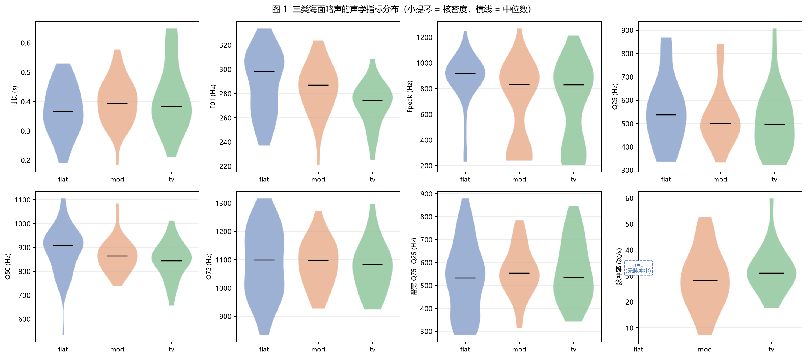

# 01  描述性统计与三类鸣声的主要差异

> 对应题面第 1 项：对鸣声时长、特征频率、峰值频率、频谱四分位数与脉冲率进行描述性统计与可视化，比较三种鸣声类型的主要差异。

数据：`Data01_AfricanPenguins_seasurface_calls_acoustics.csv`，n=108（flat 44 / mod 40 / tv 24），无缺失（除结构性缺失）。

---

## 1. 数据结构与缺失模式（关键前提）

| 变量 | flat | mod | tv | 说明 |
|---|---|---|---|---|
| Duration | 44 | 40 | 24 | 完整 |
| F01（第一基频） | 44 | 40 | 24 | 完整 |
| **F02（第二基频）** | **0** | **0** | **24** | 结构性缺失：仅双声型有两个声源 |
| Fpeak | 44 | 40 | 24 | 完整 |
| Q25 / Q50 / Q75 | 44 | 40 | 24 | 完整 |
| **PulseRate** | **0** | **34** | **20** | 结构性缺失：flat 无脉冲串 |

**这两处缺失不是随机缺失（MAR），而是定义性缺失**：
- F02 只在 tv 出现 → 它是“双声”这一定义的直接体现；
- PulseRate 在 flat 全缺 → flat 为持续等频呼叫，包络无脉冲串结构。

因此后续所有涉及这两个变量的分析，都必须按“可得样本”分别处理，不能用插补。

---

## 2. 描述统计总表

（完整版见 `_表1_描述统计.csv`）

| 指标 | 类型 | n | 均值 | 标准差 | 中位数 | 四分位区间 | CV |
|---|---|---|---|---|---|---|---|
| 时长 (s) | flat | 44 | 0.371 | 0.087 | 0.367 | [0.315, 0.432] | 0.235 |
| | mod | 40 | 0.398 | 0.080 | 0.394 | [0.349, 0.446] | 0.201 |
| | tv | 24 | 0.415 | 0.118 | 0.383 | [0.344, 0.462] | 0.283 |
| F01 (Hz) | flat | 44 | 289.5 | 26.6 | **298.0** | [266.8, 310.0] | 0.092 |
| | mod | 40 | 284.0 | 21.7 | **287.0** | [271.5, 298.5] | 0.077 |
| | tv | 24 | 271.0 | 18.4 | **274.5** | [263.8, 282.0] | 0.068 |
| F02 (Hz) | tv | 24 | 304.0 | 18.2 | 303.5 | [299.8, 315.8] | 0.060 |
| Fpeak (Hz) | flat | 44 | 868.9 | 206.4 | **916.0** | [825.5, 964.3] | 0.237 |
| | mod | 40 | 667.4 | 316.0 | **831.0** | [285.0, 906.8] | **0.474** |
| | tv | 24 | 676.3 | 321.2 | **829.5** | [296.0, 912.8] | **0.475** |
| Q25 (Hz) | flat | 44 | 557.3 | 149.9 | 537.5 | [468.0, 622.3] | 0.269 |
| | mod | 40 | 530.7 | 127.2 | 501.0 | [460.3, 557.3] | 0.240 |
| | tv | 24 | 510.7 | 140.6 | 495.0 | [407.0, 587.3] | 0.275 |
| Q50 (Hz) | flat | 44 | 889.4 | 103.1 | 908.0 | [825.5, 937.0] | 0.116 |
| | mod | 40 | 865.7 | 69.6 | 864.5 | [821.5, 900.0] | 0.080 |
| | tv | 24 | 846.0 | 79.3 | 844.5 | [826.8, 891.5] | 0.094 |
| Q75 (Hz) | flat | 44 | 1088.7 | 126.0 | 1099.0 | [986.0, 1195.8] | 0.116 |
| | mod | 40 | 1089.0 | 84.8 | 1097.5 | [1030.3, 1151.0] | 0.078 |
| | tv | 24 | 1075.1 | 92.0 | 1083.0 | [1018.3, 1118.8] | 0.086 |
| 脉冲率 (次/s) | mod | 34 | 28.9 | 11.8 | 28.4 | [21.7, 35.7] | 0.408 |
| | tv | 20 | 32.5 | 9.4 | 31.1 | [27.5, 35.3] | 0.288 |

**派生特征**（自行构造，用于后续建模）

| 派生特征 | 定义 | flat | mod | tv | 用途 |
|---|---|---|---|---|---|
| 带宽 | Q75 − Q25 | 533 [382, 617] | 554 [488, 609] | 535 [457, 650] | 频率弥散度（三类几乎相同） |
| 脉冲数 | 时长 × 脉冲率 | — | 10.4 | 12.5 | 单位呼叫的信息码元数 |
| 谱偏度 | (Q75+Q25−2Q50)/(Q75−Q25) | −0.204 | −0.201 | −0.212 | 频谱对称性（三类几乎相同） |

---

## 3. 逐指标解读

### 3.1 时长：无差异

中位数 0.367 / 0.394 / 0.383 s，Kruskal–Wallis H=2.523，p=0.283，ε²=0.005。

**结论：时长不能区分类型。** 题面把时长列为主要度量，但在本数据中它几乎无信息量——这一点必须如实报告，不应为了“凑显著性”而强解释。

### 3.2 F01：约 24 Hz 的单调梯度

298.0 → 287.0 → 274.5 Hz（flat > mod > tv），CV 仅 0.07–0.09（个体间很一致）。

这是三类中**唯一呈现单调梯度**的连续量，可视为“声源基频随类型递减”的经验规律。但绝对差距只有 7.6%（298→274.5），单靠它分类力有限（方向修正后 AUC=0.573）。

### 3.3 Fpeak：**双峰**，不是单峰

这是本题最重要的一个发现。看图 1 第三格：flat 的分布集中在 820–960 Hz；而 mod/tv 的分布**两端都有堆积**（约 290 Hz 与约 900 Hz 各一团），小提琴图呈明显的“哑铃形”。

拆开看峰值落在哪里（以 Fpeak/F01 < 2 判为“峰值在基频”）：

| 类型 | 峰值在基频 | 峰值在第 3 谐波 | Fpeak 的 CV |
|---|---|---|---|
| flat | **11.4%**（5/44） | 88.6% | 0.24 |
| mod | **37.5%**（15/40） | 62.5% | 0.47 |
| tv | **37.5%**（9/24） | 62.5% | 0.47 |

而三类的 **Fpeak/F01 中位数都恰好是 3.00** —— 谐波位置完全一致。

**所以三类在 Fpeak 上的差异是“混合比例差异”，不是“位置平移”。** 均值（flat 869 vs mod 667）之所以看起来差很多，正是被那 12.5%–26% 的低值样本拉低的。

这个现象有三重意义：
1. 均值/中位数这类汇总量在此**失效**；
2. 秩检验（KW）能抓住，因为它对分布形状敏感 —— 这是“KW 不是中位数检验”的最佳例证；
3. 生态上可解释：能量放在基频（~290 Hz）利于远距离传播（低频衰减慢），放在第 3 谐波（~900 Hz）利于近距离定位与个体识别。**这直接连到第四项的“传输稳健性”讨论。**

### 3.4 频谱四分位数：弱差异、高度共线

Q25/Q50/Q75 的中位数三类相差均在 3% 以内，CV 都很小（0.08–0.28）。三者彼此高度相关（r = 0.39–0.60），且与 F01 相关。

**主成分分析**：PC1 解释 40.7%，其载荷几乎全部来自频谱四分位（Q50 −0.57、Q25 −0.47、Q75 −0.45、F01 −0.39、Fpeak −0.32），而 Duration 仅 −0.02。

> 也就是说：**6 个指标实际上只有一条主轴——“频谱能量落在多高”**。这解释了为什么单指标能显著、多元 R² 却只有 4.9%。

### 3.5 脉冲率：只有 mod/tv 有，且两者无差异

- flat：**0/44**（无脉冲串）；
- mod：28.4 次/s（IQR 21.7–35.7），CV 0.41，范围 7.3–52.8；
- tv：31.1 次/s（IQR 27.5–35.3），CV 0.29，范围 17.6–60.0。

mod 与 tv 的脉冲率差异：Mann–Whitney U=279，p=0.279，Cliff's δ=−0.18，**不显著**。

并且检验力不足：合并 SD=11.0 次/s，n=(34,20) 在 80% 检验力下只能检出约 **11.0 次/s（1.0 SD）** 的差异，实测差 3.6 次/s 对应检验力约 **0.20**。**因此“不显著”不能解读为“无差异”。**

离散度也测了：mod 的平均绝对偏差 9.47 vs tv 6.43，置换检验 p=0.122 —— 连“变异不同”这条路也不成立。

### 3.6 带宽与谱偏度：无差异

带宽 533 / 554 / 535 Hz，谱偏度 −0.20 / −0.20 / −0.21，三类几乎重合。**说明三类共享同一套谐波结构，差异不在“频带宽度”或“谱形不对称”上。**

---

## 4. 小结

| 指标 | 是否有类型差异 | 效应量 | 判读 |
|---|---|---|---|
| 时长 | 否（p=0.283） | ε²=0.005 | 无信息 |
| **F01** | **是**（q=0.031） | ε²=0.068 | 单调梯度，弱–中 |
| **Fpeak** | **是**（q=0.013） | ε²=0.098 | **双峰比例差异**，中 |
| Q25 | 否（p=0.340） | ε²=0.002 | 无信息 |
| Q50 | 边缘（q=0.081） | ε²=0.042 | 弱 |
| Q75 | 否（p=0.771） | ε²=−0.014 | 无信息 |
| 带宽 / 谱偏度 | 否 | — | 无信息 |
| 脉冲率（mod vs tv） | 否（p=0.279） | δ=−0.18 | 但检验力仅 0.20 |
| **F02 有无** | **是**（p<1e-4） | δ=−1.00 | 完全分离（定义性） |
| **脉冲串有无** | **是**（p<1e-4） | δ=−0.85 | 完全分离（定义性） |

**一句话**：三类鸣声的差异**不在汇总量上，而在结构特征与峰位构成上**。这是第二项（分类器）与第四项（指标选取）的直接依据。
