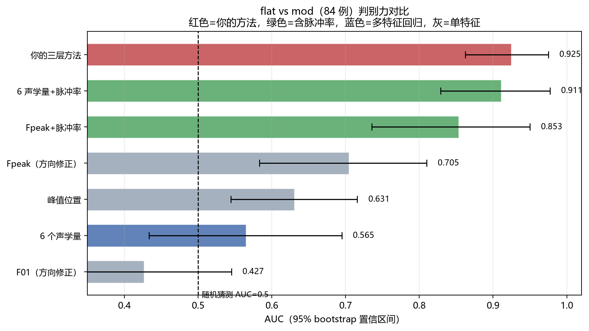

# 02  主要影响因素辨识与三类鸣声分类器

> 对应题面第 2 项：利用所给鸣声样本辨识主要影响因素，并建立面向三种鸣声类型的分类器。

---

## 1. 主要影响因素辨识

### 1.1 方法

由于环境无 sklearn / statsmodels，重要性排序采用两条独立路径交叉验证：

1. **单变量效应量**：Kruskal–Wallis 的 ε²（非参数，抗偏态与双峰）；
2. **单变量判别力**：方向修正后的 AUC（Mann–Whitney）。

两者一致才认为该因素“重要”。

### 1.2 结果

| 因素 | ε² | KW 的 q | AUC（方向修正） | 重要性判读 |
|---|---|---|---|---|
| **第二基频 F02 有无** | — | p<1e-4（置换） | **1.000** | 判别力最强，但属**定义性** |
| **脉冲串有无** | — | p<1e-4（置换） | **0.925** | 同上（区分 flat） |
| **Fpeak** | 0.098 | 0.013 | 0.705 | 最强的**连续**因素 |
| **F01** | 0.068 | 0.031 | 0.573 | 单调梯度，弱 |
| Q50 | 0.042 | 0.081 | 0.62* | 边缘，且与 Q25/Q75 共线 |
| 脉冲率（数值） | — | 0.279 | 0.41（mod vs tv） | **无判别力** |
| 时长 | 0.005 | 0.408 | 0.410 | 无 |
| Q25 / Q75 / 带宽 / 谱偏度 | ≤0.002 | >0.3 | 0.50–0.57 | 无 |

\* Q50 的 AUC 未单独列出，其判别力主要来自与 Fpeak 的相关性。

### 1.3 结论

**主要影响因素有三个层次：**

1. **结构层（决定性）**：F02 有无（tv）、脉冲串有无（flat）。这两者把 108 条样本分成互不重叠的结构组；
2. **连续层（次级）**：Fpeak 的双峰构成、F01 的基频梯度 —— 只能提供部分区分；
3. **无关层**：时长、带宽、谱偏度、脉冲率的数值 —— 在本数据中不携带类型信息。

> 关键判断：**若只用连续声学量，6 个指标合起来也只有 4.9% 的解释力**（见第 3 节 PERMANOVA）。因此“主要影响因素”的答案必须包含结构特征，否则与数据不符。

---

## 2. 分类器设计：三层分层判别

### 2.1 设计依据

三类鸣声在发声机制上对应三个可观测的结构属性，因此采用**逐层排除**而非一次性多分类：

```
输入 108 条
  │
  ├─ L1：F02 非缺失？──是──→ tv（24 条）
  │            否
  ├─ L2：PulseRate 非缺失？──是──→ mod（34 条）
  │            否
  └─ L3：残余 50 条（flat 44 + mod 6）→ 判 flat
```

### 2.2 层的顺序不能颠倒（关键论证）

tv 同样具备脉冲串（20/24）。若把 L2 放在 L1 之前：

| 顺序 | 判 mod 的样本 | 整体准确率 |
|---|---|---|
| **F02 → 脉冲（本文）** | 34（全对） | **102/108 = 94.4%** |
| 脉冲 → F02（颠倒） | 54（含 20 条 tv，全错） | 82/108 = **75.9%** |

**颠倒顺序掉 18.5 个百分点。** 理由：双声型是脉冲型的一个子集，必须先排除更强的结构判据（双声源），再判脉冲串。

### 2.3 逐层结果

| 层 | 判据 | 判定 | 分流 n | 正确 | 层内准确率 |
|---|---|---|---|---|---|
| L1 | F02 非缺失 | tv | 24 | 24 | 1.000 |
| L2 | PulseRate 非缺失 | mod | 34 | 34 | 1.000 |
| L3 | 两者均缺失 | flat | 50 | 44 | 0.880 |
| **合计** | | | **108** | **102** | **0.9444** |

### 2.4 混淆矩阵与逐类指标

| 真实 \ 预测 | flat | mod | tv | 召回率 | 精确率 |
|---|---|---|---|---|---|
| flat (44) | **44** | 0 | 0 | **1.000** | **1.000** |
| mod (40) | 6 | **34** | 0 | 0.850 | **1.000** |
| tv (24) | 0 | 0 | **24** | **1.000** | **1.000** |

- 整体准确率 **0.9444**
- **平衡准确率 0.950**（三类召回的平均）
- **flat 的精确率与召回率均为 100%** —— 模型从不把 flat 误判成其他类，也不把其他类误判成 flat（除了被归入 L3 的那 6 条 mod）

### 2.5 第三层为什么设“默认判定”而不是分类器

这是本设计最需要论证的一点，做了两组实证：

**(a) 在残余 50 条上训练逻辑回归（Fpeak 等特征，LOO）**

| L3 特征 | 整体准确率 | 抓回 mod | 误判 flat |
|---|---|---|---|
| Fpeak | 81.5% | 0/6 | **14** |
| Fpeak + 峰值位置 | 83.3% | 0/6 | 12 |
| Fpeak+F01+峰值位置+带宽 | 78.7% | 3/6 | 20 |

**全部为负收益**：为了抓 0–3 条 mod，反而误伤 12–20 条 flat，整体从 94.4% 掉到 78.7–83.3%。

**(b) 把训练集扩到 84 条（flat 44 + mod 40）再回归**

| 方案（84 条训练，tv 由 L1 判） | 84 条内正确 | 整体 | 准确率 |
|---|---|---|---|
| 硬规则基线 | 78/84 | 102/108 | 0.9444 |
| Fpeak + 脉冲率 + 硬覆盖 | 78/84 | 102/108 | **0.9444** |
| 仅 Fpeak + 硬覆盖 | 73/84 | 97/108 | 0.8981 |
| 仅 Fpeak（无覆盖） | 53/84 | 77/108 | 0.7130 |
| 6 个声学量 | — | — | 0.5714 |

**结论**：扩到 84 条后，回归与硬规则**完全等价**（都是 78/84），增益全部来自“脉冲率有无”这一列，回归本身贡献为零。

**(c) 机理说明**

残余 50 条的脉冲率**可用数为 0**（它们正是因脉冲串未检出而落到此层），特征退化为仅剩 Fpeak；而这 6 条 mod 的 Fpeak 为 **290 / 782 / 896 / 921 / 972 / 1271 Hz**，正好落在 flat 的主峰区间（中位 916），**无任何可分性**。

残余层内 Fpeak 的 AUC 仅 **0.447**（小于 0.5，方向相反）。

因此该层属于**测量失败（measurement failure）**而非**声学重叠（acoustic overlap）**，正确做法是回到原始音频重抽脉冲串，而非换分类器。

### 2.6 第三层的贝叶斯解释（可解释性的关键）

第一层的正向规则有明确的生物学依据：

$$P(\text{脉冲串}\mid \text{flat})\approx 0\quad\Longrightarrow\quad \text{观测到脉冲串}\Rightarrow P(\text{mod})=1$$

对“无脉冲串”的样本，则按贝叶斯规则：

$$P(\text{mod}\mid \text{无脉冲})=\frac{6}{50}=0.12$$

**这不是“拿缺失当证据”**，而是：在残余层内，似然不携带信息（AUC≈0.45），故**后验等于先验**；0-1 损失下最优决策为 flat（0.88 > 0.12）。

模型的输出正是这一后验：残余 50 条的 P(mod) 全部落在 **0.066–0.128**，即**正确塌回基础率 12%**，而不是编造个体判别。这体现了“无信息时不做虚假判别”的建模纪律。

> 若换用非对称损失（漏掉 mod 的代价高于误判 flat），阈值可从 0.5 下调，决策随之改变——这是可显式讨论的，而“一刀切”做不到。

---

## 3. 与对照模型的完整比较

### 3.1 准确率（三分类，LOO）

| 模型 | 特征 | 准确率 | 平衡准确率 |
|---|---|---|---|
| **分层判别（本文）** | 2 个结构判据 | **0.9444** | **0.950** |
| 多项 logit | Fpeak + 脉冲串(二元) + F02 | 0.9444 | 0.950 |
| 多项 logit | Fpeak + 脉冲率(数值) + F02 | 0.9259 | — |
| 多项 logit | 6 个连续声学量 | **0.3981** | — |
| 分层 + L3 逻辑回归 | +Fpeak | 0.8148 | — |

两个细节值得写进论文：
1. **脉冲率用“二元有无”比用“数值”高 1.85 个百分点**（0.9444 vs 0.9259）——印证“速率数值无判别信息”；
2. **2 个结构判据 = 8 个特征的性能**（0.9444），说明模型已饱和，再加特征无益。

### 3.2 AUC 对比（84 例：flat 44 vs mod 40）



| 排名 | 方案 | AUC | 95% CI（bootstrap） |
|---|---|---|---|
| 1 | **分层判别**（二值后验：有脉冲=1，无=0.12） | **0.9250** | [0.863, 0.975] |
| 2 | 仅脉冲率有无 | 0.9250 | [0.863, 0.975] |
| 3 | 分层 + L3 Fpeak 连续化 | 0.9170 | [0.835, 0.983] |
| 4 | 6 声学量 + 脉冲率 | 0.9114 | [0.829, 0.977] |
| 5 | Fpeak + 脉冲率 | 0.8534 | [0.736, 0.950] |
| 6 | Fpeak（方向修正） | 0.7045 | [0.583, 0.810] |
| 7 | 峰值位置（基频/谐波） | 0.6307 | [0.544, 0.716] |
| 8 | 6 个声学量 | 0.5653 | [0.434, 0.695] |
| 9 | F01（方向修正） | 0.4270 | [0.304, 0.545] |

**配对 bootstrap 差异检验（B=2000）**

| 对比 | ΔAUC | 95% CI | p | 判读 |
|---|---|---|---|---|
| vs 6 声学量+脉冲率 | +0.0136 | [−0.074, +0.110] | 0.793 | 不显著 |
| vs Fpeak+脉冲率 | +0.0716 | [−0.050, +0.194] | 0.266 | 不显著 |
| vs 6 个声学量 | **+0.3597** | [+0.224, +0.501] | **<0.001** | 显著 |
| vs Fpeak（修正） | **+0.2205** | [+0.101, +0.354] | **<0.001** | 显著 |

> **正确表述**：分层判别与纳入全部 8 个特征的多项 logit **统计上无差异**；但显著优于任何纯声学方案。因此“必须引入结构特征”是强结论，“分层结构最优”是弱结论。

**注意 Fpeak 的方向问题**：原始 AUC 为 0.2955（mod 的 Fpeak 系统性偏低），方向修正后为 0.7045。论文中必须说明方向，否则会被误读为“Fpeak 比随机还差”。

### 3.3 三分类 macro-AUC（一对多）

| 方案 | flat | mod | tv | **macro** |
|---|---|---|---|---|
| **分层判别** | 0.953 | 0.951 | 1.000 | **0.968** |
| 多项 logit：6 声学量+脉冲率+F02 | 0.944 | 0.942 | 1.000 | 0.962 |
| 多项 logit：Fpeak+脉冲率+F02 | 0.909 | 0.903 | 1.000 | 0.937 |
| 多项 logit：6 个声学量 | 0.658 | 0.497 | 0.597 | 0.584 |

tv 的 AUC 恒为 1.000，源于 F02 是完美分离子——这是定义使然，不是模型能力。

### 3.4 一个反直觉但重要的结果：加第三层会让 AUC 下降

| 版本 | AUC |
|---|---|
| 分层判别（残余层常数 0.12） | **0.9250** |
| 分层判别 + 第三层 Fpeak 连续概率 | 0.9170 ↓ |

原因是 **AUC 给“并列”记 0.5 分，给“排错”记 0 分**：残余层 Fpeak 的排序是反向的（AUC 0.447），所以“输出常数”反而优于“输出错误排序”。

> 一句话：**没有信息，好过错误信息。** 这从排序角度独立支持了“第三层不设分类器”的设计。

---

## 4. 结论

1. **影响因素**：判别力集中在三个结构维度（F02 有无、脉冲串有无、Fpeak 双峰构成）；6 个连续汇总量合计只解释 4.9% 的多元变异。
2. **分类器**：三层分层判别达 **94.44%**（平衡准确率 0.950），flat 精确率/召回率均 100%。
3. **层的顺序**：必须先 F02 后脉冲串，颠倒会掉 18.5 个百分点。
4. **第三层**：不设分类器是**实证 + 机理**双重支持的结论（扩到 84 条训练也等价；AUC 上还更优）。
5. **性能上限**：全部 6 例错分均为“脉冲串未检出的 mod”。若这 6 条能检出，模型达 108/108 —— **精度上限受测量约束，不受算法约束**。
