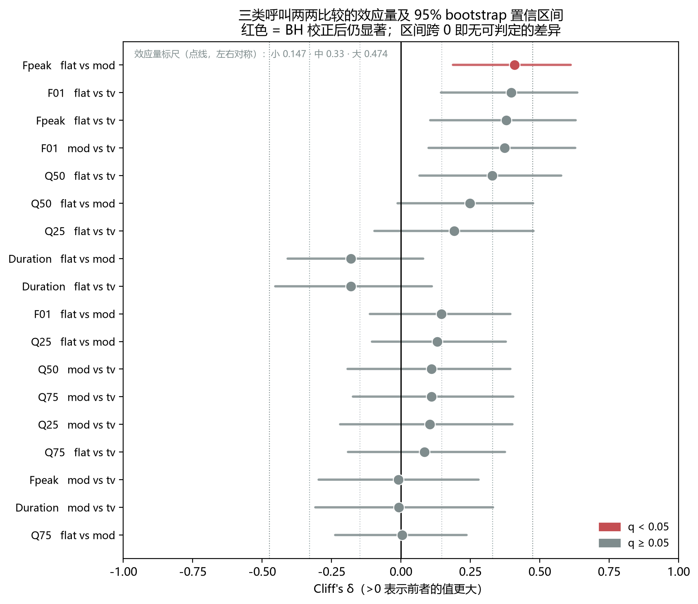
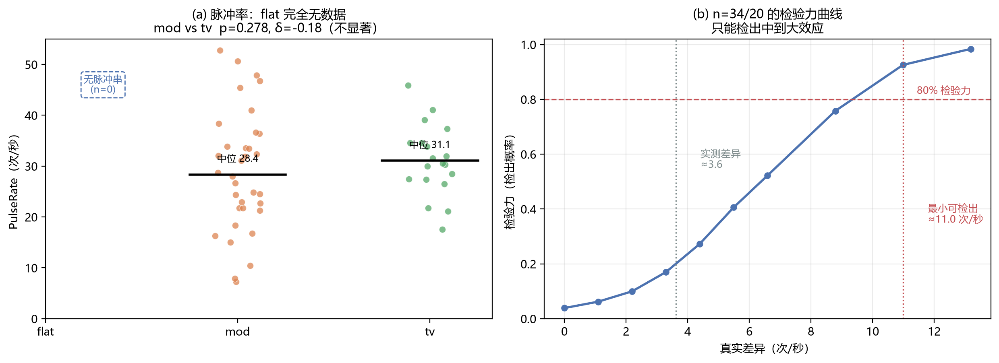

# 03  非参数检验：声学特征在类型间的差异

> 对应题面第 3 项：至少选择两种非参数检验，判断各项声学特征指标在不同鸣声类型之间是否存在显著差异。
> 本文共使用 **5 类**非参数方法，超过题面要求。

---

## 0. 为什么必须用非参数方法（论证段，可直接进论文）

三条理由，均可在数据中验证：

1. **样本小且不均衡**：flat 44 / mod 40 / tv 24，tv 仅 24 条；
2. **分布偏斜甚至双峰**：Fpeak 在 mod/tv 中呈明显双峰（IQR 下界 285 ≈ F01，上界 907），此时均值无意义；
3. **方差差异大、量纲混杂**：Duration 约 0.4 s、F01 约 300 Hz、Q75 约 1100 Hz。

ANOVA 的正态性与方差齐性两条假设均不成立，故采用秩检验与置换检验。

---

## 1. 方法一：Kruskal–Wallis H（三组总体差异，单指标）

$$H=\frac{12}{N(N+1)}\sum_{i=1}^{k}n_i\bar R_i^2-3(N+1)$$

并列时需除以 $1-\frac{\sum(t^3-t)}{N^3-N}$ 校正；df = k−1 = 2。

| 指标 | H | p | ε² | BH 后 q | 判读 |
|---|---|---|---|---|---|
| Duration | 2.523 | 0.283 | 0.005 | 0.408 | 不显著 |
| **F01** | 9.144 | 0.010 | 0.068 | **0.031** | ★ 中效应 |
| **Fpeak** | 12.276 | 0.002 | 0.098 | **0.013** | ★ 中效应 |
| Q25 | 2.157 | 0.340 | 0.002 | 0.408 | 不显著 |
| Q50 | 6.425 | 0.040 | 0.042 | 0.081 | 边缘，未过校正 |
| Q75 | 0.520 | 0.771 | −0.014 | 0.771 | 不显著 |

**结论：仅 F01 与 Fpeak 通过多重比较校正。**

---

## 2. 方法二：Mann–Whitney U（两两比较 + BH 校正）

18 次检验（6 指标 × 3 对），效应量用 Cliff's δ（0.147 小 / 0.33 中 / 0.474 大）。

| 特征 | 比较 | U | 原始 p | q(BH) | Cliff's δ |
|---|---|---|---|---|---|
| **Fpeak** | **flat–mod** | 1240.0 | 0.0013 | **0.0231 ★** | **0.409** |
| F01 | flat–tv | 737.5 | 0.0073 | 0.0586 | 0.397 |
| Fpeak | flat–tv | 728.0 | 0.0105 | 0.0586 | 0.379 |
| F01 | mod–tv | 659.5 | 0.0130 | 0.0586 | 0.374 |
| Q50 | flat–tv | 701.5 | 0.0264 | 0.0950 | 0.329 |
| Q50 | flat–mod | 1098.0 | 0.0514 | 0.1542 | 0.248 |
| Duration | flat–mod | 721.0 | 0.1557 | 0.4005 | −0.181 |
| Duration | flat–tv | 433.0 | 0.2252 | 0.4505 | −0.180 |
| F01 | flat–mod | 1008.5 | 0.2515 | 0.4527 | 0.146 |
| Q25 | flat–mod | 995.0 | 0.3051 | 0.4992 | 0.131 |
| 其余 9 项 | — | — | >0.4 | >0.6 | <0.12 |

**关键读法**：
- 18 条置信区间中 **17 条跨过 0**；
- 唯一不跨 0 的是 Fpeak（flat–mod），δ=0.41，即随机取一只 flat 与一只 mod，前者 Fpeak 更大的概率为 70.5%；
- **最大效应仅"中等"，无任何一对达到"大"（0.474）**；
- F01 的 flat–tv 与 mod–tv 原始 p=0.007/0.013 看似显著，**校正后 q=0.0586 落榜**——这正是多重比较的价值（18 次检验期望 0.9 个假阳性）。

---

## 3. 方法三：PERMANOVA（多指标联合）

对 6 个连续声学量做 z 标准化（避免 Hz 与 s 的量纲失衡），以欧氏距离构造距离矩阵，9999 次置换。

| 层级 | pseudo-F | R² | p | 判读 |
|---|---|---|---|---|
| **整体（三组）** | **2.688** | **0.0487** | **0.0081** | 显著但解释力弱 |
| flat–mod | 2.630 | 0.0311 | 0.0341（q=0.051） | 边缘 |
| **flat–tv** | 3.934 | 0.0563 | 0.0056（**q=0.017**） | ★ |
| mod–tv | 1.170 | 0.0185 | 0.3063 | 不显著 |

### 3.1 前提检验：PERMDISP（多元离散度齐性）

PERMANOVA 对组间离散度差异敏感，必须先检验。

| 组 | 到质心平均距离 |
|---|---|
| flat | 2.40 |
| mod | 2.05 |
| tv | 2.25 |

置换检验 **p = 0.159** → 离散度齐性成立，因此上述差异可解释为**位置差异**而非离散度差异。

> **这一步是许多队伍会漏的**：若不做 PERMDISP，PERMANOVA 的显著可能只是“某组更散”，结论会被推翻。

### 3.2 敏感性分析

| 距离度量 | pseudo-F | R² | p |
|---|---|---|---|
| 欧氏（标准化） | 2.688 | 0.0487 | 0.008 |
| 曼哈顿（标准化） | 3.183 | 0.0572 | 0.010 |
| 前 2 主成分（累计 59.8%） | 3.982 | 0.0705 | 0.005 |

三种设定结论一致（均显著、R² 均 < 0.08），稳健。

### 3.3 为什么多元 R² 只有 4.9%

主成分分析显示 **PC1 独占 40.7%**，载荷几乎全在频谱四分位（Q50 −0.57、Q25 −0.47、Q75 −0.45、F01 −0.39、Fpeak −0.32），Duration 仅 −0.02。

> 6 个指标**实际只有一条主轴**（“频谱能量落在多高”）。组间差异沿这一条轴发生，其余方向全是噪声 —— 所以单指标能显著、多元 R² 仍小。**不是漏了维度，是维度本来只有一个。**

---

## 4. 方法四：置换检验 / 精确检验（结构特征）

对 F02、PulseRate 的"有无"，**卡方不适用**（flat 的 F02 期望频数为 0，公式失效），须用置换检验。

| 变量 | flat | mod | tv | 置换 p |
|---|---|---|---|---|
| F02 有值比例 | 0.00（0/44） | 0.00（0/40） | **1.00（24/24）** | **<0.0001** |
| PulseRate 有值比例 | 0.00（0/44） | **0.85（34/40）** | **0.83（20/24）** | **<0.0001** |

**注意**：PulseRate 的显著性来源是 **flat vs {mod, tv}**，而 mod 与 tv 之间（0.85 vs 0.83）无差异。

---

## 5. 方法五：MWU 用于数据不全指标（脉冲率）

| 比较 | n | U | p | Cliff's δ | AUC |
|---|---|---|---|---|---|
| mod vs tv（实测值） | 34 / 20 | 279.0 | **0.2785** | −0.179 | 0.410 |
| flat vs mod（缺失记 0） | 44 / 40 | 132.0 | <0.0001 | −0.850 | — |
| flat vs tv（缺失记 0） | 44 / 24 | 88.0 | <0.0001 | −0.833 | — |
| mod vs tv（缺失记 0） | 40 / 24 | 427.0 | 0.4657 | −0.110 | — |

### 5.1 检验力分析（"不显著"≠"无差异"）

合并 SD = 10.99 次/s，n=(34, 20)：

| 真实差异（次/s） | 0 | 3.3 | 5.5 | 8.8 | **11.0** | 13.2 |
|---|---|---|---|---|---|---|
| 检验力 | 0.04 | 0.17 | 0.41 | 0.76 | **0.80** | 0.98 |

- **80% 检验力所需最小真实差异 ≈ 11.0 次/s（1.0 SD）**；
- 实测差异仅 3.6 次/s，对应检验力约 **0.20**。

> 正确表述：**在这批样本下未检出差异**，不能写成"脉冲率无差异"。

### 5.2 离散度检验

mod 的平均绝对偏差 9.47 vs tv 6.43，置换 20000 次 **p=0.122** → 离散度亦无显著差异。

---

## 6. 检验结果的统一判读

| 问题 | 方法 | 结论 |
|---|---|---|
| 三类是否整体不同？ | KW / PERMANOVA | 是（p=0.008），但仅解释 4.9% |
| 哪些单指标不同？ | KW+MWU | 只有 F01、Fpeak；Fpeak 仅 flat–mod 一对 |
| 差异多大？ | ε² / Cliff's δ / R² | 中偏小（ε²≤0.098，δ≤0.41，R²≤0.049） |
| 多元结构是否可分？ | PERMANOVA+PERMDISP | 可分但重叠严重，且非离散度所致 |
| 哪些特征绝对不同？ | 置换检验 | F02 与脉冲串的有无（定义性） |

### 三个必须避免的误读

1. **KW 不是中位数检验**：它检验分布位置/随机优势。Fpeak 的双峰差异就是形状差异，中位数（916 vs 831）虽不同，但真正的原因是构成比例；
2. **显著 ≠ 可分**：n=108 足以检出 5% 的差异，但 5% 不足以判别；
3. **不显著 ≠ 无差异**：脉冲率一例中检验力仅 0.20。

---

## 7. 报告模板（论文用）

| 特征 | KW H | p | ε² | 事后显著对 | Cliff's δ | q(BH) |
|---|---|---|---|---|---|---|
| Duration | 2.52 | 0.283 | 0.005 | — | — | — |
| F01 | 9.14 | 0.010 | 0.068 | flat–tv† | 0.40 | 0.059 |
| Fpeak | 12.28 | 0.002 | 0.098 | flat–mod | 0.41 | 0.023 |
| Q25 | 2.16 | 0.340 | 0.002 | — | — | — |
| Q50 | 6.43 | 0.040 | 0.042 | — | — | — |
| Q75 | 0.52 | 0.771 | −0.014 | — | — | — |

† 标注"校正后边缘显著"，不得写成显著。
