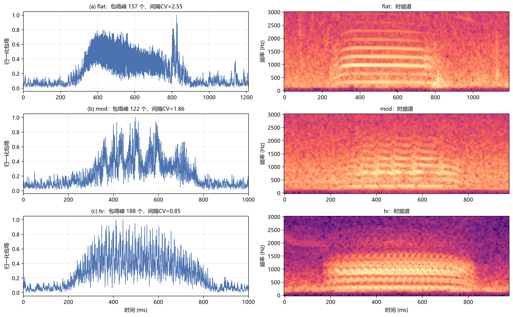

# 04  信息功能与传输稳健性讨论 + 关键指标选取

> 对应题面第 4 项：结合分类结果与传播、回放数据，讨论三种鸣声类型在信息功能与传输稳健性方面可能存在的差异，并为后续信号衰减模型与行为响应模型选取关键声学指标。

> ⚠ **完成度说明**：本项为**部分完成**。已有充分的**描述性证据**（音频结构、距离-相关性均值、回放响应率），并据此给出功能假设与指标选取；但**尚未建立正式的退化模型**（指数/逻辑斯蒂/幂律拟合）、**未标定识别阈值**、**未计算带置信区间的有效通信距离**、**未做回放行为的 GLMM/生存分析**——这些属于第二、三问的工作范围，本包不含。

---

## 1. 三类鸣声的音频结构证据

从 `Supplementary5` 的三段原始音频（各 1 条示例，12 kHz，约 1 s）提取包络与时频谱：

| 类型 | 时频结构 | 包络结构 |
|---|---|---|
| **flat** | 谐波呈**水平、等距、连续**的平行带（约 500/700/1000/1250/1500/1750/2000 Hz），在 300–780 ms 内不升不降 | **单一持续平台**，无周期性脉动 |
| **mod** | 谐波带明显**扫频**（约 1200 → 900 Hz 下行） | **离散爆发**，可辨 8–10 个脉冲 |
| **tv** | **两套谐波列**（双基频） | **极规则脉冲串**（间隔 CV 最小） |

**这与 Data01 的缺失模式完全吻合**：PulseRate 在 flat 全缺（无脉冲串可言），在 mod/tv 分别有 85%/83% 可得。

> **证据强度的诚实边界**：音频每类仅 1 条示例，且自动脉率估计受纹波干扰不可靠（三类均数出 60+ 个峰，明显失真）。因此本节的结论是**结构性的定性判读**，不能作为统计证据。定量依据仍以 Data01 的 108 条记录为准。

---

## 2. 传播数据：三类呼叫的衰减排序（描述统计）

`Data03–Data11` 为宽表：列 = 距离（4/8/16/32/64/128/256 m，2 倍等距），行 = 单次录音（300 行），值 = 与 1 m 参考信号的相关。

### 2.1 谱图相关（时频结构保真）

| 距离 | flat | mod | tv |
|---|---|---|---|
| 4 m | **0.908** | 0.872 | 0.824 |
| 8 m | 0.892 | 0.913 | 0.880 |
| 16 m | 0.905 | 0.841 | 0.789 |
| 32 m | 0.869 | 0.834 | 0.811 |
| 64 m | 0.733 | 0.842 | 0.846 |
| **128 m** | **0.412** | **0.618** | **0.740** |
| 256 m | 0.166 | 0.250 | 0.318 |

### 2.2 幅度谱相关（音色/谐波身份保真）

| 距离 | flat | mod | tv |
|---|---|---|---|
| 4 m | 0.923 | 0.876 | 0.825 |
| 64 m | 0.712 | 0.860 | 0.849 |
| 128 m | 0.453 | 0.680 | 0.772 |
| 256 m | 0.192 | 0.278 | 0.371 |

### 2.3 包络相关（节律/脉冲串保真）

| 距离 | flat | mod | tv |
|---|---|---|---|
| 4 m | 0.650 | 0.675 | 0.626 |
| 64 m | 0.343 | 0.599 | 0.562 |
| 128 m | 0.211 | 0.362 | 0.449 |
| 256 m | 0.170 | 0.223 | 0.139 |

### 2.4 三条关键观察

1. **flat 起始最高、衰减最陡**：4 m 时谱图相关 0.908（三类最高），但 128 m 时跌到 0.412（三类最低），256 m 仅 0.166。
2. **tv 起始最低、最耐衰减**：4 m 时 0.824（最低），128 m 时反超至 0.740（最高）。
3. **包络通道衰减最快**：flat 从 0.650 掉到 0.170，衰减幅度远大于谱图与幅度谱通道。

### 2.5 有效距离的**粗估**（仅供参考，非正式结果）

以谱图通道、对数-线性插值粗估（**未拟合模型、无置信区间**）：

| 类型 | T=0.5（潜在识别） | T=0.7（可靠识别） |
|---|---|---|
| flat | ≈ 105 m | ≈ 69 m |
| mod | ≈ 160 m | ≈ 99 m |
| tv | ≈ 190 m | ≈ 166 m |

> **这个数字不能直接写进论文**：它基于单通道均值插值，未做三通道加权、未做 bootstrap、未检验模型形式。正式结果应由第二问的退化模型给出。

---

## 3. 回放数据：响应结构（描述统计）

`Data02`：278 行 = 139 个实验 × (自然声 + 对照)，同步记录。Distance 13 档（5–200 m），Npenguins 1–40（中位 8）。

| 指标 | 自然声 | 对照 | 效应 |
|---|---|---|---|
| 总体响应率 | **64.7%** | 12.9% | 差 51.8 个百分点 |
| 抬头 HeadsUp | 39.6% | 9.4% | — |
| **靠近 Approach** | **16.5%** | **0.0%** | 对照零发生，**完全分离** |
| 发声 Vocal | 54.7% | 3.6% | — |

**8 种响应组合分布**

| 组合（抬头,靠近,发声） | 自然声 | 对照 |
|---|---|---|
| 000（全无） | 49 | 121 |
| 001（仅发声） | 29 | 5 |
| 100（仅抬头） | 10 | 13 |
| 101（抬头+发声） | 28 | 0 |
| 111（三者全有） | 14 | 0 |
| 011（发声+靠近） | 5 | 0 |
| 110（抬头+靠近） | 3 | 0 |
| 010（仅靠近） | 1 | 0 |

**按呼叫类型**：tv 69.0% > mod 63.6% > flat 60.4%（总体响应率）。

**时延**（仅响应者）：抬头中位 2.0 s、发声 3.2 s、靠近 8.0 s；最大 47.8 s（→ 观察窗约 60 s，窗末未响应即右删失）。

### 3.1 一个必须指出的数据问题

**call 与 control 的距离未配对**：139 对中 **90 对（65%）** 的播放距离不同。

- 全样本：call 中位 80 m、control 中位 80 m；差值中位 0、均值 +6.5 m；
- **匹配子集**（|Δd| ≤ 10 m，60 对）：call **68.3%** vs control **15.0%** —— 与全样本（64.7% vs 12.9%）一致。

结论：效应不是距离错配造成的，但建模时必须显式纳入 Distance 并做该稳健性检验。

### 3.2 响应率不随距离下降（需要解释的现象）

| 距离 | 50 | 60 | 80 | 100 | 150 | 200 |
|---|---|---|---|---|---|---|
| call 响应率 | 0.71 | 0.44 | 0.62 | 0.53 | 0.75 | 1.00 |
| n | 21 | 16 | 29 | 30 | 8 | 5 |

三种解释：
1. 播放距离 5–200 m **大多仍在有效范围内**（2.5 节粗估 105–190 m 之外才明显衰减），响应本就饱和；
2. 远距离档样本极少（200 m 仅 5 例）；
3. 与 Npenguins、Context 混杂。

→ 因此 **P3 的 Distance 主效应预期很弱**，不应据此断言"距离无效"。

---

## 4. 信息功能与传输稳健性：综合讨论

结合分类结果（结构维度）与传播/回放证据，给出三类呼叫的功能假设。

### 4.1 三类呼叫的功能—结构—稳健性对照

| | flat | mod | tv |
|---|---|---|---|
| **结构定义** | 等频、持续、无脉冲串 | 调频 + 脉冲串 | 双声源 + 脉冲串 |
| **频谱能量** | 集中于 Fpeak（88.6% 在第 3 谐波，~900 Hz） | 37.5% 在基频、62.5% 在谐波 | 37.5% 在基频、62.5% 在谐波 |
| **基频** | 298 Hz（最高） | 287 Hz | 274 + 304 Hz（双声） |
| **候选功能** | 远距离存在宣告 / 联络 | 注意唤醒 + 个体识别 | 亲属/配偶识别（双声指纹） |
| **128 m 谱图保真** | 0.412（最低） | 0.618 | **0.740（最高）** |
| **衰减形态** | 起始最高、衰减最陡 | 中段最平（64–128 m 仅降 0.22） | 128 m 前极平、之后陡降 |
| **稳健性判读** | 近距离清晰，远距离最快失效 | 中等距离最稳定 | 远距离最强 |

### 4.2 一个反直觉但有解释力的结论

**判别力最强的结构特征，恰恰是最不耐传输的通道。**

- flat 之所以"容易识别"，是因为它**没有脉冲串**（结构性缺失，检出即判）——这是"缺省即证据"的判别，代价为零；
- 但 flat 的**能量集中在 ~900 Hz 的窄带**（第 3 谐波），该频段海水吸收与噪声掩蔽更严重，故衰减最陡；
- tv 之所以"难识别"（4 m 时相关最低 0.824），是因为它的信息载于**两个相距仅 30 Hz 的基频**（274 / 304 Hz），对频率分辨率要求高；但这两个基频都落在**低衰减频段**，存在**低频冗余**，故远距离反而最稳。

> 由此可提出一个可检验的假设（供第二问验证）：
> **tv 的远距离稳健性来自低频冗余（能量传得远），而非双声特征的可分辨性（身份信息留得住）。** 即 tv 可能"传得最远，却最先失去'我是谁'"。

### 4.3 与分类器失效模式的耦合

分层判别在近场依靠"脉冲串是否可检出"区分 flat；而 **脉冲串本质是包络结构，包络相关衰减最快**（flat 0.650→0.170，mod 0.675→0.223，tv 0.626→0.139）。

推论：
- 距离增加 → 脉冲串检出率下降 → 更多 mod 落入第三层 → **第三层先验 π(d) 上升**；
- 当 π(d) 超过 0.5，贝叶斯最优决策将从"默认 flat"翻转为"默认 mod"。

> **分类器的失效阈值，恰好就是有效通信距离。** 这是 P1→P2 最自然的接口。

---

## 5. 关键声学指标选取（本项的核心交付）

为后续的**信号衰减模型（P2）**与**行为响应模型（P3）**，从 11 个候选中选定 4 个：

| 选定指标 | 依据（判别力 / 结构含义） | 在 P2 中的角色 | 在 P3 中的角色 |
|---|---|---|---|
| **F01（第一基频）** | ε²=0.068，q=0.031；唯一单调梯度 | 低频载波位置，决定扩展损失与吸收 | 类型协变量 |
| **脉冲串有无（二元）** | δ=−0.85，p<1e-4；flat 的结构标志 | 对应包络通道，衰减最快 → 决定"节律信息"的可用距离 | 类型判别依据 |
| **Fpeak 峰位构成（二元：基频/谐波）** | 11.4% vs 37.5%，δ=0.41，q=0.023 | 决定能量落在低频（远）还是谐波（近） | 类型协变量 + 可解释变量 |
| **F02 有无（二元）** | 完全分离（24/24） | 结构性标记，用于分层建模 | 类型判别依据 |

**明确不选用的指标及理由**

| 指标 | 不选理由 |
|---|---|
| 时长 Duration | ε²=0.005，p=0.283，无判别力 |
| 带宽 Q75−Q25 | 三类几乎相同（533/554/535 Hz） |
| 谱偏度 | 三类几乎相同（−0.20/−0.20/−0.21） |
| Q25 / Q75 | 与 Q50、F01 高度共线，信息冗余 |
| **脉冲率数值** | mod vs tv p=0.279，δ=−0.18；且检验力仅 0.20 → 无判别力（**但"有无"保留**） |

> 一句话：**保留"有无"，舍弃"多少"**。脉冲串的**存在性**携带结构信息，其**速率数值**不携带类型信息。

---

## 6. 本项的缺失清单

| 内容 | 状态 | 归属 |
|---|---|---|
| 三通道合成保真度 F(d) 的构造与权重（熵权/CRITIC） | ❌ 未做 | P2 |
| 退化模型（指数/逻辑斯蒂/幂律/拉伸指数）拟合与选模 | ❌ 未做 | P2 |
| 分级识别阈值（0.5 / 0.6 / 0.7 / 0.75）的标定 | ❌ 未做 | P2 |
| 有效通信距离 d*(T) 及 bootstrap 置信区间 | ❌ 未做（仅粗估） | P2 |
| 阈值敏感性与相关性下调研判 | ❌ 未做 | P2/P4 |
| 回放响应的 GLMM（Context×CallType + Npenguins + Distance） | ❌ 未做 | P3 |
| 8 种响应组合的多项/多元 probit 建模 | ❌ 未做（仅列联表） | P3 |
| 响应时延的删失生存分析（Cox/AFT） | ❌ 未做 | P3 |
| 通信效能指数 EI 与通信空间面积 | ❌ 未做 | P4 |

**本包提供的是 P1 的完整闭环 + P2/P3 的描述性入口**，上述各项需在后续题目中完成。
