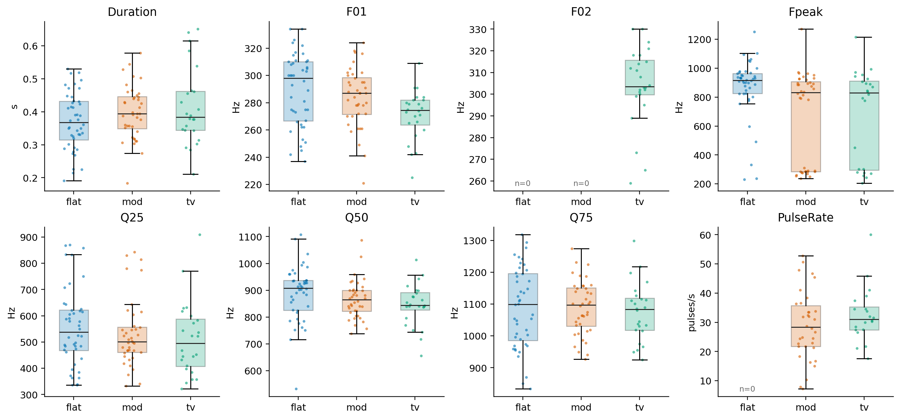

# 01 描述性统计与可视化

## 分析思路

以单条鸣声为观测单位，按三种鸣声类型统计有效样本数、缺失数、均值、样本标准差、中位数及四分位数。雨云图将分布、组内四分位区间和单条观测放在一起，可同时看出总体位置、离散程度与组间重叠。Q25、Q50、Q75 是单条鸣声累计频谱能量达到 25%、50%、75% 时对应的频率。下表方括号则是同一类型内多条观测的第 25 和第 75 百分位。

清洗后的 Data01 有平直型 44 条、调制型 40 条和双声型 24 条。时长、F01、Fpeak、Q25、Q50、Q75 三组完整。F02 只有双声型 24 条有测值。脉冲率在调制型和双声型分别有 34 条、20 条有效观测。每项指标按自己的有效观测统计。

## 按鸣声类型比较

下表为中位数［P25，P75］。

| 指标 | 平直型 flat | 调制型 mod | 双声型 tv |
|---|---:|---:|---:|
| 鸣声时长（s） | 0.367［0.315，0.432］ | 0.394［0.349，0.446］ | 0.383［0.344，0.462］ |
| 第一基频 F01（Hz） | 298.0［266.8，310.0］ | 287.0［271.5，298.5］ | 274.5［263.8，282.0］ |
| 第二基频 F02（Hz） | — | — | 303.5［299.75，315.75］ |
| 峰值频率 Fpeak（Hz） | 916.0［825.5，964.2］ | 831.0［285.0，906.8］ | 829.5［296.0，912.8］ |
| 频谱分位频率 Q25（Hz） | 537.5［468.0，622.2］ | 501.0［460.2，557.2］ | 495.0［407.0，587.2］ |
| 频谱分位频率 Q50（Hz） | 908.0［825.5，937.0］ | 864.5［821.5，900.0］ | 844.5［826.8，891.5］ |
| 频谱分位频率 Q75（Hz） | 1099.0［986.0，1195.8］ | 1097.5［1030.2，1151.0］ | 1083.0［1018.2，1118.8］ |
| 脉冲率（次/s） | — | 28.36［21.72，35.73］ | 31.07［27.46，35.27］ |

- **时长。** 三组的中间 50% 区间重叠较多。双声型的样本标准差约为 0.118 s，高于平直型的 0.087 s 和调制型的 0.080 s。
- **基频。** F01 中位数由平直型、调制型到双声型依次降低。双声型每条观测的 F02 均高于该条的 F01。
- **峰值频率。** 平直型 Fpeak 中位数比调制型和双声型分别高 85.0 和 86.5 Hz。以 500 Hz 作为描述性切点，低于该值的观测分别为 4/44、15/40、9/24。差异同时表现在位置与低频观测比例。
- **频谱分位频率。** 平直型 Q25 和 Q50 样本中位数最高。平直型和双声型的 Q50 相差 63.5 Hz。三类 Q75 中位数最大差为 16.0 Hz。
- **脉冲率。** 对有效观测而言，双声型的中位数比调制型高约 2.71 次/s，组内四分位区间仍重叠。

完整统计表也保留了预处理中已有的频谱四分位带宽 Q75−Q25，三组样本中位数分别为 533.0、554.5、535.0 Hz。

## 图像与结果文件

- [八幅单指标雨云图合集](figures/nature_style/APMCM_C_Q1_Nature.pdf)，同目录保留各指标的 PNG、PDF 和 SVG。
- [首次绘制的雨云图合集](figures/first_version/APMCM_C_Q1_Rainclouds.pdf)。
- [原预处理分布总图](figures/Q1_acoustic_distributions.png)。
- [指标分组完整统计表](tables/Q1_descriptive_statistics.csv) · [此前描述统计修订稿](previous_descriptive_report.md) · [统计与分布总图复现脚本](../code/descriptive.py)。

Fpeak、F01 和 Q50 的样本差异为后续比较提供候选特征。正式的组间检验和折外分类表现分别见 [非参数检验](../03_nonparametric/report.md) 和 [分类模型](../02_classification/report.md)。
