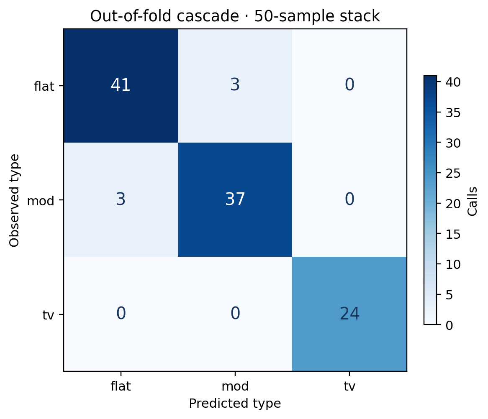
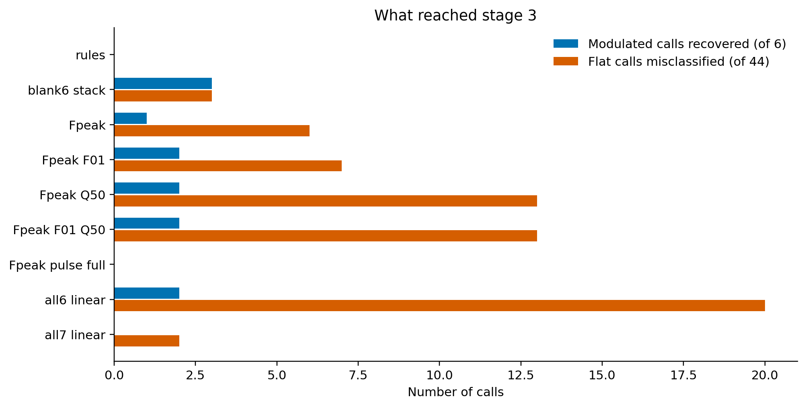

# 02 三类鸣声的判别特征与分类模型

## 判别思路与模型

先看特征的可用性和结构差异，再评价剩余难分样本。Data01 的 24 条双声型均有 F02，其他类型均空。40 条调制型中 34 条有脉冲率测值，44 条平直型的脉冲率全空。这两个字段在现有测量口径下提供了较清楚的分流规则。Fpeak 在单指标检验中差异最明确，因而作为第三层的单指标候选，与 F01、Q50 的组合一并对照。

1. **第一层**按 F02 有有效测值识别双声型，共 24 条。
2. **第二层**在其余记录中按脉冲率有有效测值识别调制型，共 34 条。
3. **第三层**对剩余 44 条平直型和 6 条脉冲率无测值的调制型进行二分类。原方案以时长训练一个逻辑回归，以 F01、Fpeak、Q25、Q50、Q75 训练另一个逻辑回归，再把两者对调制型的折外分数输入上层逻辑回归。

每个逻辑回归使用 L2 正则化、\(C=1\) 与平衡类别权重。主比较固定使用 0.50 阈值，标准化和脉冲率中心值均从训练折计算。按日期与地点组合分批，外层每次留出整个批次，堆叠的内层也按批次产生折外分数。Data01 共 16 批，其中 14 批含平直型或调制型，11 批含第三层记录。表内的 84 条直接分类与 50 条第三层表现均为折外结果。打包的模型使用全部 50 条第三层样本重训，供演示预测。

## 折外结果

规则基线在第三层把全部记录判为平直型，三层整体正确 102/108。原 50 条训练的六指标堆叠同样正确 102/108（94.4%），调制型召回率从 85.0% 升至 92.5%，平直型召回率从 100% 降至 93.2%。双声型在 Data01 上为 24/24。调制型的三个新增正确判断抵消了三个平直型误报。

| 第三层方案 | 84 条直接判对 | 84 条 AUC | 找回空脉冲率 mod（6 条） | 误报 flat（44 条） | 第三层判对（50 条） | 三层判对（108 条） |
|---|---:|---:|---:|---:|---:|---:|
| 双规则基线 | 78 | 0.925 | 0 | 0 | 44 | 102 |
| 50 条训练 · 六指标堆叠 | — | — | 3 | 3 | 44 | 102 |
| 84 条训练 · 六指标堆叠 | 29 | 见 CSV | 0 | 31 | 13 | 71 |
| 84 条训练 · 七指标堆叠 | 77 | 见 CSV | 0 | 1 | 43 | 101 |
| 84 条训练 · 六指标单层 | 42 | 0.497 | 2 | 20 | 26 | 84 |
| 84 条训练 · 七指标单层 | 75 | 0.905 | 0 | 2 | 42 | 100 |
| Fpeak | 53 | 0.690 | 1 | 6 | 39 | 97 |
| Fpeak＋F01 | 54 | 0.624 | 2 | 7 | 39 | 97 |
| Fpeak＋Q50 | 50 | 0.672 | 2 | 13 | 33 | 91 |
| Fpeak＋F01＋Q50 | 49 | 0.610 | 2 | 13 | 33 | 91 |
| Fpeak＋脉冲率测值指示 | 78 | 0.875 | 0 | 0 | 44 | 102 |
| Fpeak＋测值指示＋脉冲率实测项 | 78 | 0.876 | 0 | 0 | 44 | 102 |

七指标版由六项完整指标加脉冲率构成。脉冲率编码为是否有测值与仅在有实测时激活的中心化脉冲率项。缺失时该数值项贡献为零，原测值仍保留为空。旧版 50 样本实验另比较了单层六指标和训练折内选阈值，分组折外结果分别为 32/50 和 44/50，详见 [原始三层分类器交付](../code/previous_versions/q1_three_stage/README.md)。

## 为什么全样本表现和第三层表现不同

有脉冲率测值的 34 条调制型已被第二层识别，这批样本的 Fpeak 中位数为 820 Hz。第三层剩余 6 条调制型的 Fpeak 中位数为 908.5 Hz，与平直型 916 Hz 接近。加入 34 条容易识别的调制型扩大了训练集，同时改变了训练构成。Fpeak 单项在 84 条直接分类上的 AUC 高于六指标单层模型，实际第三层只找回 1 条调制型。加入 F01 在阈值 0.50 下多找回 1 条，同时多误报 1 条。加入 Q50 的方案误报更多。

带脉冲率的 Fpeak 模型在 84 条上判对 78 条，分类结果与测值分流规则一致。第三层全部 50 条均无脉冲率测值，6 条调制型均被判为平直型。按现有分流目标衡量，在已比较方案中，原 50 条训练的六指标堆叠保留了更好的召回与误报权衡。它找回原表第 10、49、79 条。其余三条调制型来自同一批次，留出该批时第三层训练集中只有三条调制型。新批次的召回率仍缺少独立录音验证。

## 结果和代码

- [分类结果总表](tables/classification_metrics.csv) · [逐条折外标签与分数](tables/classification_oof.csv) · [六条难例](tables/six_hard_mod_cases.csv) · [混淆矩阵数值](tables/cascade_confusion.csv)。
- [用全部 84 条训练的原始交付](../code/previous_versions/q1_stage3_expanded/README.md) · [整合复现脚本](../code/classification.py) · [预测脚本](../code/predict_cascade.py) · [可载入的重训模型](models/cascade_50_stage3.joblib)。
