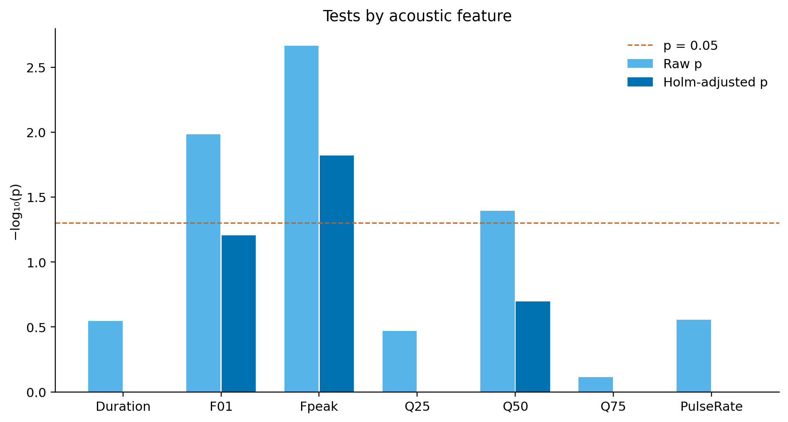

# 03 声学特征的非参数检验

## 问题和检验设计

题目首先要求逐项判断声学特征是否随鸣声类型而变化。对每项完整指标，用 Kruskal–Wallis（KWH）比较三组的秩分布，平局取平均秩并校正检验统计量。对仅两类有有效观测的脉冲率，用双侧 Mann–Whitney U（MWU）比较调制型和双声型。F02 只有双声型有测值，给出组内描述统计。七个可检验项目统一进行 Holm 校正，检验阈值取 0.05。随后使用 PERMANOVA 回答六项特征联合后是否存在组间差异。[KWH 说明](https://docs.scipy.org/doc/scipy/reference/generated/scipy.stats.kruskal.html) · [MWU 说明](https://docs.scipy.org/doc/scipy/reference/generated/scipy.stats.mannwhitneyu.html)

## 单指标结果

三组 KWH 的样本数为 44/40/24，自由度为 2。脉冲率有效样本数为 34/20。

| 特征 | 检验 | 统计量 | 原始 p | Holm 校正后 p |
|---|---|---:|---:|---:|
| 鸣声时长 | KWH | 2.523 | 0.2832 | 1.0000 |
| F01 | KWH | 9.144 | 0.0103 | 0.0620 |
| **Fpeak** | **KWH** | **12.276** | **0.0022** | **0.0151** |
| Q25 | KWH | 2.157 | 0.3400 | 1.0000 |
| Q50 | KWH | 6.425 | 0.0402 | 0.2012 |
| Q75 | KWH | 0.520 | 0.7712 | 1.0000 |
| 脉冲率 | MWU | 279.000 | 0.2785 | 1.0000 |
| F02 | 仅双声型有测值，中位数 303.5 Hz | — | — | — |

F01、Fpeak 和 Q50 的原始 \(p\) 均低于 0.05。七项同时检验时，仅 Fpeak 通过 Holm 校正。F01 中位数依次为平直型 298.0 Hz、调制型 287.0 Hz、双声型 274.5 Hz，校正后结果可表述为组间差异迹象。脉冲率的结果限定在有测值的子样本。双声型 F02 的中间 50% 区间为 299.75–315.75 Hz。

**先前的两两比较。** 使用 18 个可能组对统一 Holm 校正，Fpeak 的平直型与调制型比较达到显著水平（MWU 校正后 \(p=0.0231\)，Cliff’s \(\delta=0.409\)）。两组 Fpeak 样本中位数为 916 和 831 Hz。平直型与双声型的 Fpeak 原始 \(p=0.0105\)，按该校正范围为 0.1673。其他组对完整保存在结果表。

## 多指标 PERMANOVA

选用时长、F01、Fpeak、Q25、Q50、Q75 六项完整特征，对每列作 Z 标准化，基于样本间欧氏距离计算
\[
F_{\text{pseudo}} =
\frac{SS_{\text{between}}/(k-1)}{SS_{\text{within}}/(n-k)},
\qquad
R^2 = \frac{SS_{\text{between}}}{SS_{\text{total}}}.
\]
总体和组对比较各用 49,999 次置换，固定随机种子 20261126。三组总体自由度为 2 和 105，三项两两比较各使用同一标准化尺度，其 \(p\) 值统一做 Holm 校正。用以空间中位数为中心、按样本量校正的 PERMDISP 检查组内离散度。[PERMANOVA](https://vegandevs.github.io/vegan/reference/adonis.html) · [PERMDISP](https://vegandevs.github.io/vegan/reference/betadisper.html)

| 比较 | 伪 F | R² | 置换 p（总体原始，组对 Holm） |
|---|---:|---:|---:|
| **三类总体** | **2.688** | **4.87%** | **0.0079** |
| flat vs mod | 2.630 | 3.11% | 0.0589 |
| **flat vs tv** | **3.934** | **5.63%** | **0.0162** |
| mod vs tv | 1.170 | 1.85% | 0.3108 |

六维特征的整体效应显著，平直型与双声型的差异最明确。鸣声类型解释约 4.87% 的总变异，样本组内变异仍占主要部分。PERMDISP 未检出显著离散度差异（\(F=1.934\)，\(p=0.1497\)）。

按日期与地点组合控制批次并限制置换后，三组整体仍显著（\(p=0.0020\)），平直型与双声型的校正后 \(p=0.0099\)。只保留 False Bay 录音，总体 \(p=0.0117\)。移除 Fpeak 后五项指标的联合检验 \(p=0.0579\)，说明联合结果对是否纳入峰值频率较敏感。缺少企鹅个体编号，无法确认多个录音是否来自同一只企鹅。

## 已做过的补充对照

- **多样本 Anderson–Darling。** 对各指标采用中秩统计和 19,999 次置换。单独对七项校正后 Fpeak、F01 的 \(p\) 分别为 0.0175、0.0237。该方法评估分布整体差异，F01 的结果随检验而变。
- **分块秩置换。** 按日期与地点组合限制置换，19,999 次，校正后 Fpeak 和 F01 的 \(p\) 分别为 0.0028 和 0.0108。它是对录音批次处理的敏感性结果。
- **PC1 上的 MWU。** 六项标准化指标的第一主成分解释 40.7% 的总变异，Q50 的权重最大。平直型与双声型的 PC1 得分差异显著（三个组对 Holm，\(p=0.0391\)）。这一对照检验对应综合频谱方向，六维整体结论来自 PERMANOVA。

[单项检验表](tables/univariate_tests.csv) · [两两 MWU](tables/exploratory_MWU_pairs.csv) · [分块秩置换](tables/blocked_rank_sensitivity.csv) · [总体 PERMANOVA 和敏感性检查](tables/PERMANOVA_overall.csv) · [两两 PERMANOVA、PERMDISP 和 PC1 比较](tables/PERMANOVA_pairs.csv) · [PC1 权重](tables/PCA_PC1.csv) · [代码](../code/nonparametric.py)。
