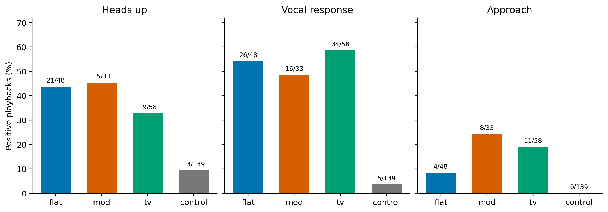
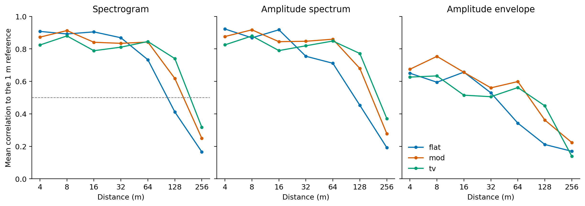

# 04 信息功能、传播稳健性与后续声学指标

## 从分类、回放到传播的分析思路

分类结果提供区分声学结构的线索。F02 指示双声结构，脉冲率是否有测值可帮助识别部分调制型，Fpeak 则描述主导频率的组间差异。回放数据提供接收者行为证据。抬头可视为警觉或察觉的表现，鸣叫回应支持联系功能，靠近声源支持潜在招募功能。传播数据用于判断各类鸣声的结构能在多远保留。在这一逻辑下，同一类型的声学结构、行为和传播证据可以共同支持一种功能假设。[回放实验与指标定义](https://ore.eu/article/view/1538/version/2510)

## 回放证据与功能解释

Data02 有 139 组配对实验，各记录一次自然鸣声回放及一次海浪声对照。行为率的分母为该类刺激的播放次数。

| 回放刺激 | 抬头 | 鸣叫回应 | 靠近声源 |
|---|---:|---:|---:|
| 平直型（48 次） | 21/48（43.8%） | 26/48（54.2%） | 4/48（8.3%） |
| 调制型（33 次） | 15/33（45.5%） | 16/33（48.5%） | 8/33（24.2%） |
| 双声型（58 次） | 19/58（32.8%） | 34/58（58.6%） | 11/58（19.0%） |
| 海浪声对照（139 次） | 13/139（9.4%） | 5/139（3.6%） | 0/139（0.0%） |

- **平直型更符合联系信号的解释。** 较多的抬头和鸣叫回应表明同伴能察觉并回应平直型。原研究的多层模型中，平直型相对对照的靠近效应未达到显著水平。[发表论文](https://ore.eu/article/view/1538/version/2510)
- **调制型兼具潜在招募功能。** 鸣叫回应支持联系功能。靠近的观察率为 24.2%，原研究报告相对对照有显著的靠近效应。时频变化与包络起伏是待检验的定位线索。[发表论文](https://ore.eu/article/view/1538/version/2510)
- **双声型也可能兼具联系与招募。** 回应率约 58.6%，靠近约 19.0%。原研究同样报告了相对对照的靠近效应。双基频相互作用形成的拍频可作为机制假设。两类鸣声靠近率的点估计反映本样本的观察，功能差别还需结合情境和不确定性解释。[发表论文](https://ore.eu/article/view/1538/version/2510)

回放使用整段鸣声，因此峰值频率、调制、拍频各自的独立行为效应还没有估计。配对后的计数见 [matched_playback_counts.csv](tables/matched_playback_counts.csv)。建模时保留每次回放自己的距离，在 139 组中有 90 组两次回放的距离值不同。

## 传输稳健性

对 Data03–11 的有效相关系数按测量方式、鸣声类型与距离分组，计算其相对 1 m 录音的平均相关。观测距离为 4、8、16、32、64、128、256 m。

| 鸣声类型 | 128 m 时频图相关 | 128 m 振幅频谱相关 | 128 m 振幅包络相关 | 平均时频图相关跨过 0.5 的距离区间 |
|---|---:|---:|---:|---|
| 平直型 | 0.412 | 0.453 | 0.211 | 64–128 m |
| 调制型 | 0.618 | 0.680 | 0.362 | 128–256 m |
| 双声型 | 0.740 | 0.772 | 0.449 | 128–256 m |

平直型的时频结构较早衰减，调制型和双声型在 128 m 保留更多时频和频谱结构。到 256 m，双声型的时频相关仍最高（0.318）。该距离的振幅包络则以调制型最高（调制型 0.223、平直型 0.170、双声型 0.139）。可分别讨论频谱结构和包络结构的保真度。0.5 是对比相似度的阈值。测量在实验条件下完成，实际听觉辨识与通信距离仍需额外验证。[传播实验设计与结果](https://ore.eu/article/view/1538/version/2510)

## 后续模型的指标选择

| 模型 | 现有表格支持的指标 | 获得逐轨道录音后可提取的指标 |
|---|---|---|
| 信号衰减 | 响应优先用**时频图相关系数**，振幅频谱相关、振幅包络相关用于分结构比较。解释变量优先用**距离、鸣声类型及其交互** | **Fpeak 与 Q50**用于描述峰值和能量位置的保留。**包络调制强度与脉冲率**描述时间调制，**F02−F01**描述双声结构 |
| 行为响应 | **刺激类型**为主要声学解释变量。响应分别用**抬头、鸣叫、靠近**。控制觅食情境、每次回放距离、群体大小，按 `expID` 保留配对。鸣叫模型可用回放前鸣叫数作基线 | **包络调制强度与脉冲率**优先对应靠近假设。**Fpeak**描述主导频率，**有无双基频与双基频间距**对应双声结构假设 |

对于衰减模型，可分别拟合三种相关指标随距离的曲线并报告达到预设相似度阈值的距离。传播矩阵的同一录音参与多次两两相关，原始矩阵行号仅用于回查。行为数据有回放轨道编号，估计逐轨道声学效应前需匹配轨道及其声音特征。同类型的 Data01 平均值只代表类级信息。

[传播分组汇总](tables/propagation_by_measure_distance.csv) · [阈值区间](tables/spectrogram_0p5_brackets.csv) · [回放行为汇总](tables/playback_by_stimulus.csv) · [配对计数](tables/matched_playback_counts.csv) · [觅食情境汇总](tables/natural_playback_by_context.csv) · [代码](../code/evidence.py)。
