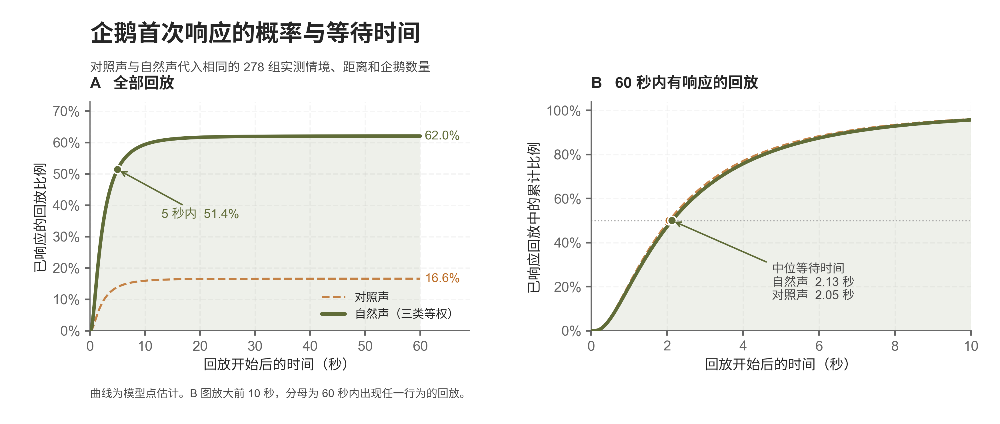
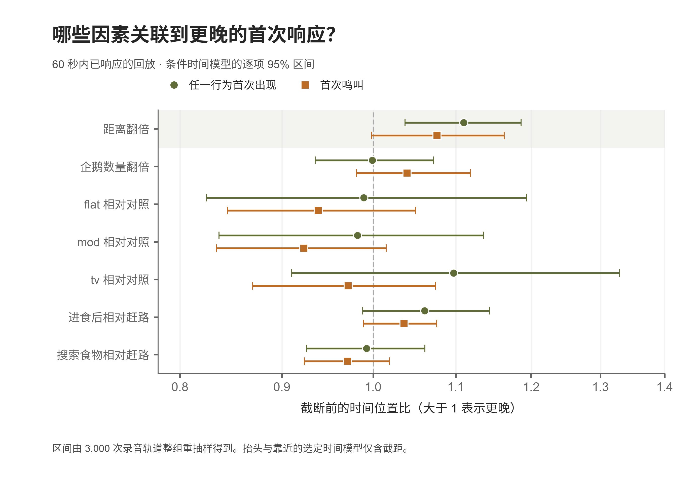
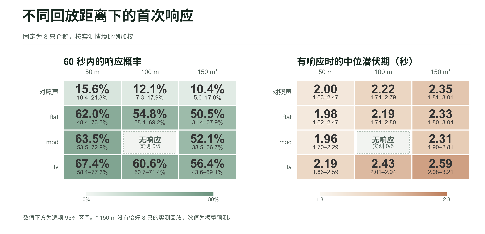

# 亚太赛 C 题第三问的结论与推导过程

**第 1 部分比较总体响应率。** 139 对海上回放中，自然鸣声有 90 次引起至少一种响应，对照声有 18 次，实测响应率分别为 **64.75%** 和 **12.95%**。将不同声音放在相同的情境、距离和企鹅数量下比较，模型估计仍相差 **50.28 个百分点**。

**第 2 部分分析四个因素与三种行为的关系。** 在可复现的两阶段重拟合中，自然声相对对照的抬头、鸣叫和靠近调整概率分别高 **27.21、42.01、12.63 个百分点**。自然声从 50 m 改为 100 m 时，抬头概率下降。群体从 4 只变为 8 只时，鸣叫概率下降。搜索食物情境中的鸣叫概率点估计较高，区间判断随模型规格变化。

**第 3 部分比较一次回放后出现哪些行为组合。** 自然鸣声改变了八种结果的整体分布。`flat`、`mod`、`tv` 分别与对照声比较，都提高了**仅鸣叫、抬头＋鸣叫、三种行为都出现**的概率。其中，自然声总体的「抬头＋鸣叫」概率增幅最大，为 **19.40 个百分点**。三种自然鸣声之间的直接比较仍有较大不确定性。

**第 4 部分建立响应潜伏期模型。** 将 60 秒内发生的概率与发生后的等待时间结合。留轨道验证为任一行为的首次响应和鸣叫保留了四因素时间项，为抬头和靠近选择了合并估计的时间分布。首个行为的条件潜伏期随距离增加而变长，声型之间的潜伏期差异估计仍有较大不确定性。

## 1. 总体响应概率

### 1.1 从配对记录得到实测差异

Data02 有 278 条记录，按 `expID` 构成 139 对，每对都有一次自然声和一次对照声回放。每条记录对应一个企鹅群的一次回放。观察窗内只要出现抬头、鸣叫或靠近中的任一种，就记为有响应。这个定义与 `ResponseYesNo` 在全部 278 条记录上一致。[Data02 原始数据](https://chatgpt.com/library?file_id=libfile_8e013f9f32608191ae1bf1f2a7a0f849&account_id=personal)

|  | 对照声有响应 | 对照声无响应 | 合计 |
| --- | ---: | ---: | ---: |
| 自然声有响应 | 16 | 74 | 90 |
| 自然声无响应 | 2 | 47 | 49 |
| 合计 | 18 | 121 | 139 |

自然声与对照声的原始概率差为 $(90-18)/139=51.80$ 个百分点。对内只有一种声音引发响应的实验共有 76 对，其中 **74 对仅自然声有响应，2 对仅对照声有响应**。在两种声音总体响应概率相等的零假设下，两种方向应各占这些不一致配对的一半。McNemar 精确检验用 $\mathrm{Binomial}(76,0.5)$ 计算双侧概率，得到 $p\approx 7.75\times10^{-20}$。

### 1.2 比较相同条件下的总体响应概率

用第 3 部分两阶段模型的第一阶段统一估计总体响应。以有无响应为因变量，建立带 L2 正则化的二元 Logistic 模型。输入包括四类声音、行为情境、实际回放距离和观测到的企鹅数量。情境按赶路、搜索食物、进食后编码，距离和企鹅数量分别以 $\log_2(d/80)$ 和 $\log_2(n/8)$ 输入。模型允许三种自然鸣声共享相对对照的共同差异，并估计各自的偏移。按 `expID` 分组验证，使同一对回放始终处在同一折。

计算调整概率时，把四类声音逐一代入同样的 278 组协变量，先逐条预测，再求平均。自然声总体取 `flat`、`mod`、`tv` 的等权平均。下表的调整概率与第 3 部分「无响应」概率互补。[模型与调整方法](https://chatgpt.com/library?file_id=libfile_038cb81ddad08191ab4877af85eacf7a&account_id=personal)

| 声音 | 调整后的任意响应概率 | 较对照增加（百分点） |
| --- | ---: | ---: |
| 对照声 | 13.65% | — |
| flat | 62.29% | +48.64 |
| mod | 63.65% | +50.00 |
| tv | 65.86% | +52.21 |
| 自然声总体 | 63.94% | **+50.28** |

自然声总体的概率差按未舍入数值计算。按录音轨道整组重抽样后，该差值在八种结果的联合比较中对应的 95% 同时置信区间为 **[40.86, 59.71] 个百分点**，由第 3 部分「无响应」概率差的区间反号得到。[按录音轨道重抽样的结果](https://chatgpt.com/library?file_id=libfile_7b099d4820d08191be4d83acaf278ae4&account_id=personal)

### 1.3 情境、声型、距离与企鹅数量的关系

下表为实测的「有响应回放数 / 总回放数」。声型分组中的对照声取该声型对应的配对对照。距离和群体规模按每次回放各自的记录分组。[总体响应率分组图](https://chatgpt.com/library?file_id=libfile_c3c06435539c8191b8410f4aebb51692&account_id=personal)

| 因素 | 分组 | 自然声 | 对照声 |
| --- | --- | ---: | ---: |
| 情境 | 赶路 | 35/65 | 6/65 |
| 情境 | 搜索食物 | 36/38 | 5/38 |
| 情境 | 进食后 | 19/36 | 7/36 |
| 自然鸣声类型 | flat | 29/48 | 6/48 |
| 自然鸣声类型 | mod | 21/33 | 4/33 |
| 自然鸣声类型 | tv | 40/58 | 8/58 |
| 距离（m） | ≤50 | 35/46 | 5/36 |
| 距离（m） | 51–80 | 27/48 | 6/60 |
| 距离（m） | 81–100 | 16/30 | 4/22 |
| 距离（m） | >100 | 12/15 | 3/21 |
| 企鹅数量 | 1–4 | 47/54 | 8/55 |
| 企鹅数量 | 5–9 | 12/21 | 3/19 |
| 企鹅数量 | 10–19 | 22/33 | 6/34 |
| 企鹅数量 | ≥20 | 9/31 | 1/31 |

自然声的实测响应率在所有列出的分组中都高于对照。搜索食物时的实测差距最大。自然声的距离分组响应率呈非单调变化，>100 米只有 15 次自然声回放。1–4 只组的自然声响应率最高，≥20 只组最低。这些是分组样本中的描述性差异。总体概率差由上节的协变量标准化得到，各分组的频数本身不足以确认距离或企鹅数量的独立作用。

## 2. 情境、声型、距离和企鹅数量与三种行为的关系

### 2.1 将组合概率转换为单项行为概率

以一次回放为观测单位，按 `HeadsUpYesNo`、`VocalYesNo` 和 `ApproachYesNo` 记录三种行为。每种行为的分母是该条件下的全部回放。同一次回放可以计入多种行为。鸣叫按数据表的响应定义编码，即播放后鸣叫次数超过播放前。

沿用第 3 部分的两阶段结构。第一阶段用二元 Logistic 模型估计出现任意响应的概率 $r(x)$，第二阶段用多项 Logistic 模型估计有响应时七种非空组合的概率 $q_k(x)$。对行为 $b$，把所有包含它的组合概率相加。

$$
P(B_b=1\mid x)
=r(x)\sum_{k\,\text{包含}\,b}q_k(x).
$$

例如，抬头概率包含仅抬头、抬头和鸣叫、抬头和靠近，以及三种行为都出现。直接从第 3 部分的原始概率表求和，自然声等权平均相对对照的抬头、鸣叫、靠近概率分别增加 **29.57、48.82 和 15.18 个百分点**。这三个差值描述的是任意出现该行为的概率。

### 2.2 四因素的比较方法

现有附件保存了两阶段模型的总体概率表，四因素情景预测和联合重抽样需要重新拟合。补充分析用相同的模型结构和协变量变换，两个阶段分别通过留一自然录音轨道交叉验证选择 L2 惩罚强度。验证时，同一轨道的所有实验和配对对照一起留出。拟合使用每次回放的实际距离和企鹅数量，139 对中有 90 对距离不同、2 对观测数量不同。主模型包含四个因素的主效应，敏感性模型允许自然声与对照在情境、距离和数量上的关系不同。

- **声型**。将 `control`、`flat`、`mod`、`tv` 分别代入同样的 278 组观测条件，逐条预测后求平均。自然声总体仍按三种鸣声等权计算。
- **情境**。把情境分别设为赶路、搜索食物或进食后，使用同一组距离和企鹅数量进行比较。搜索食物时只观测到 1–10 只，情境比较采用 2–10 只、20–150 m 范围内的 126 条记录作为标准化参照，减少超出样本范围的预测。
- **距离**。将距离从 50 m 改为 100 m，其余协变量按观测分布取值。该差值衡量所选距离范围内的平均变化。
- **企鹅数量**。将群体从 4 只改为 8 只，其余协变量按观测分布取值。该差值描述群体层面的响应概率。

在各自然声型内对 28 条录音轨道整组重抽样 3,000 次。每次重抽样保留自然声与配对对照，固定所选惩罚强度，重新拟合两阶段模型并计算单项行为概率差。以各因素内最大的标准化偏差构造族内 95% 同时置信区间。各自然声相对对照、三种自然声彼此比较，分别计算一族。区间同时反映组合概率重估后的共同变化。[复现脚本](_q3_analysis/q3_behavior_factors.py)

### 2.3 声型与三种行为

自然声与对照各回放 139 次。抬头分别观察到 **55 次和 13 次**，鸣叫 **76 次和 5 次**，靠近 **23 次和 0 次**。主模型在相同协变量下估计的对照响应概率为抬头 **11.25%**、鸣叫 **7.77%**、靠近 **3.28%**。其中靠近的概率由正则化模型估计，实测为 0/139。

| 声音相对对照 | 抬头概率差 | 鸣叫概率差 | 靠近概率差 |
| --- | ---: | ---: | ---: |
| flat | +28.87 [13.54, 44.20] | +42.11 [25.72, 58.49] | +9.17 [3.87, 14.47] |
| mod | +29.45 [20.31, 38.60] | +38.98 [24.54, 53.42] | +14.90 [8.83, 20.97] |
| tv | +23.31 [10.17, 36.46] | +44.93 [32.26, 57.61] | +13.83 [4.71, 22.95] |
| **自然声等权总体** | **+27.21 [17.31, 37.11]** | **+42.01 [30.60, 53.42]** | **+12.63 [7.11, 18.16]** |

表内为调整后概率差和 95% 同时置信区间，单位为百分点。三类自然声各自相对对照的九项比较，区间均高于零。增加最明显的是鸣叫。三类自然声彼此比较时，`mod` 的靠近概率较 `flat` 高 **5.73 个百分点 [0.34, 11.12]**，交互模型的估计为 **5.82 [0.59, 11.04]**。这两类在原始数据上分别只观察到 8 次和 4 次靠近，区间下限接近零。其余声型间比较的区间均跨零，现有数据支持把这项结果表述为具体的靠近概率差异，声型整体排名仍有较大不确定性。

### 2.4 情境、距离和企鹅数量的比较

下表仍以百分点表示概率差及 95% 同时置信区间。对照和自然声行分别表示同一组声音随条件变化的概率差。“两组差值的变化”是自然声行减去对照行，用来回答自然声相对对照的优势是否随条件变化。

| 条件变化 | 播放组 | 抬头 | 鸣叫 | 靠近 |
| --- | --- | ---: | ---: | ---: |
| 搜索食物相对赶路 | 对照声 | +2.50 [−2.77, 7.77] | +2.23 [−1.09, 5.55] | +0.71 [−0.95, 2.37] |
| | 自然声 | +1.28 [−7.19, 9.76] | +5.21 [−2.15, 12.56] | +1.59 [−4.55, 7.72] |
| | 两组差值的变化 | −1.22 [−7.47, 5.04] | +2.98 [−1.50, 7.45] | +0.88 [−3.94, 5.69] |
| 进食后相对赶路 | 对照声 | −0.70 [−7.46, 6.06] | −0.02 [−4.63, 4.60] | −0.30 [−2.33, 1.72] |
| | 自然声 | −2.79 [−16.92, 11.35] | −0.40 [−13.00, 12.20] | −0.91 [−7.15, 5.33] |
| | 两组差值的变化 | −2.09 [−11.04, 6.86] | −0.38 [−8.68, 7.91] | −0.61 [−5.16, 3.94] |
| 50 m 增至 100 m | 对照声 | −3.67 [−7.47, 0.14] | −0.67 [−3.35, 2.01] | −0.82 [−1.89, 0.26] |
| | 自然声 | **−7.35 [−13.88, −0.83]** | −2.79 [−9.86, 4.29] | −3.00 [−6.83, 0.83] |
| | 两组差值的变化 | −3.69 [−7.71, 0.34] | −2.12 [−6.71, 2.48] | −2.18 [−5.26, 0.90] |
| 4 只增至 8 只 | 对照声 | −2.56 [−5.01, −0.10] | −2.66 [−4.66, −0.66] | −1.02 [−1.89, −0.15] |
| | 自然声 | −4.29 [−9.01, 0.44] | **−7.68 [−12.32, −3.05]** | −2.05 [−5.33, 1.24] |
| | 两组差值的变化 | −1.73 [−4.91, 1.44] | −5.02 [−8.45, −1.59] | −1.03 [−3.63, 1.58] |

### 2.5 结果解释与敏感性分析

- **情境的关联主要出现在鸣叫。** 自然声组搜索食物时有 32/38 次鸣叫，赶路时为 27/65 次。调整后，搜索食物相对赶路的鸣叫概率差从主模型的 **+5.21 [−2.15, 12.56]** 变为交互模型的 **+10.22 [1.46, 18.98]** 个百分点。在交互模型中，自然声相对对照的鸣叫概率优势也扩大 **8.98 [2.36, 15.60]** 个百分点。两个模型的方向一致，区间判断随规格而变。搜索食物情境的群体规模偏小，情境结果应表述为调整后的关联。
- **距离增加时，自然声下抬头概率下降的结果最稳定。** 50 m 到 100 m，主模型的调整概率由 **41.69% 降至 34.34%**，交互模型估计下降 **8.41 [−16.06, −0.77]** 个百分点。两种规格下同一距离变化对鸣叫、靠近，以及自然声与对照之间概率差的影响，区间均跨零。距离结论对应 50–100 m 的比较。
- **群体规模与自然声下的鸣叫概率呈负关联。** 从 4 只到 8 只，主模型估计自然声组的鸣叫概率从 **55.90% 降至 48.22%**，交互模型估计下降 **10.34 [−16.33, −4.36]** 个百分点。自然声相对对照的鸣叫概率优势在两种规格下均缩小，分别为 **−5.02 [−8.45, −1.59]** 和 **−8.75 [−14.10, −3.41]** 个百分点。自然声组抬头的区间判断随规格而变，靠近的区间在两种规格下均跨零。该关系的统计单位是一次群体回放，个体的鸣叫倾向需要个体级观测。
- **交互模型的小幅预测改进主要支持检查异质性。** 留一轨道的组合对数损失由 **1.09220 降至 1.08433**。两种规格下，三种自然声相对对照均提高三种行为概率。对照组规模变化在主模型中的三个区间均低于零，在交互模型中均跨零。对照声靠近又缺少实测事件，这些对照组的规模关系应视为模型依赖的估计。

原概率表的单项行为差值与新拟合方向一致，幅度随正则化和验证方法而变。第 2 部分表内的概率和区间来自同一次可复现拟合。若要解释行为的先后顺序，需要结合潜伏期数据。

## 3. 单次回放的行为组合分布

### 3.1 第一步，从原始频数检验整体分布

将抬头、鸣叫和靠近分别记为三个二元指标。每次回放归入八种互斥结果之一。「抬头＋鸣叫」表示观察窗内出现这两种行为且未观察到靠近。行为可能来自群内不同企鹅，也可以先后出现。鸣叫按数据中的 `VocalYesNo` 判定，该指标与播放后鸣叫次数超过播放前逐行一致。[数据编码与 Code1 复核](https://chatgpt.com/library?file_id=libfile_7b099d4820d08191be4d83acaf278ae4&account_id=personal)

| 单次回放结果 | 对照声 | flat | mod | tv | 自然声合计 |
| --- | ---: | ---: | ---: | ---: | ---: |
| 无响应 | 121 | 19 | 12 | 18 | 49 |
| 仅抬头 | 13 | 2 | 4 | 4 | 10 |
| 仅鸣叫 | 5 | 8 | 3 | 18 | 29 |
| 仅靠近 | 0 | 0 | 0 | 1 | 1 |
| 抬头＋鸣叫 | 0 | 15 | 6 | 7 | 28 |
| 抬头＋靠近 | 0 | 1 | 1 | 1 | 3 |
| 鸣叫＋靠近 | 0 | 0 | 3 | 2 | 5 |
| 三种行为都出现 | 0 | 3 | 4 | 7 | 14 |
| 合计 | 139 | 48 | 33 | 58 | 139 |

把每种结果的组内频数除以该组全部回放次数，得到实测分布。自然声和对照声各有 139 次回放，两组八类频数差的绝对值合计为 150，因此两组分布的总变差距离为：

$$
T=\frac12\sum_{k=1}^{8}\left|f_{\mathrm{自然声},k}-f_{\mathrm{对照声},k}\right|=\frac{150}{2\times139}=0.540.
$$

在配对标签可交换的零假设下，每次置换都在各实验对内随机交换整条行为组合所属的声音标签，保留三个行为的联合结果。99,999 次置换中，没有一次达到实测的总变差距离，按加一规则得到 $p=0.00001$。只保留两次回放距离相等的 49 对时，得到相同的检验判断。由此可见，**自然声与对照声的八类实测分布存在整体差异**。各组合在共同条件下的差值由下一步模型估计。[置换检验与模型说明](https://chatgpt.com/library?file_id=libfile_038cb81ddad08191ab4877af85eacf7a&account_id=personal)

### 3.2 第二步，用统一模型估计八种结果的概率

第一阶段用全部 278 次回放拟合二元 Logistic 模型，得到任意响应概率 $r(x)$。第二阶段用 108 次有响应的回放拟合带 L2 正则化的多项 Logistic 模型，得到已响应时各非空组合的条件概率 $q_k(x)$。两个阶段都包括声音类别、情境、距离及企鹅数量。第二阶段直接对联合结果建模，保留行为间的关联。

$$
P(Y=\text{无响应}\mid x)=1-r(x),\qquad
P(Y=k\mid x)=r(x)q_k(x),\quad k\ne\text{无响应}.
$$

四类声音用第 1 部分相同的标准化方式比较。以「抬头＋鸣叫」为例，自然声总体的调整后任意响应概率为 63.94%，其中有响应的回放约 30.94% 属于这一组合，相乘约为 **19.78%**。对照声的组合概率估计为 **0.38%**，相减得到 **+19.40 个百分点**。对照声实测为零次，0.38% 来自正则化模型。这里的 30.94% 是标准化后该组合的概率除以标准化后的任意响应概率。

### 3.3 从概率差和区间得出结论

对 28 条自然鸣声录音轨道，按 `flat`、`mod`、`tv` 分层整组重抽样 3,000 次。每次抽到一条轨道，就保留该轨道涉及的实验及其配对对照，两阶段同时重新拟合。对自然声总体相对对照的八项差异，构造 95% 同时置信区间。各自然声分别与对照的 24 项比较，以及三种自然声之间的 24 项比较，各使用一组同时区间。[完整点估计](https://chatgpt.com/library?file_id=libfile_038cb81ddad08191ab4877af85eacf7a&account_id=personal) · [按录音轨道重抽样的区间](https://chatgpt.com/library?file_id=libfile_7b099d4820d08191be4d83acaf278ae4&account_id=personal)

| 单次回放结果 | 对照声 | flat | mod | tv | 自然声总体 | 较对照差值（百分点） | 95% 同时区间（百分点） |
| --- | ---: | ---: | ---: | ---: | ---: | ---: | ---: |
| 无响应 | 86.35% | 37.71% | 36.35% | 34.14% | 36.06% | **−50.28** | [−59.71, −40.86] |
| 仅抬头 | 8.71% | 7.09% | 7.94% | 7.77% | 7.60% | −1.11 | [−9.40, 7.19] |
| 仅鸣叫 | 3.60% | 19.13% | 19.35% | 22.75% | 20.41% | **+16.81** | [7.31, 26.31] |
| 仅靠近 | 0.17% | 0.76% | 0.80% | 0.83% | 0.80% | +0.63 | [−1.01, 2.27] |
| 抬头＋鸣叫 | 0.38% | 20.99% | 19.76% | 18.59% | 19.78% | **+19.40** | [11.57, 27.22] |
| 抬头＋靠近 | 0.21% | 2.05% | 2.19% | 2.20% | 2.15% | +1.94 | [−1.08, 4.96] |
| 鸣叫＋靠近 | 0.25% | 3.26% | 3.70% | 3.61% | 3.52% | +3.27 | [−0.25, 6.80] |
| 三种行为都出现 | 0.34% | 9.01% | 9.92% | 10.11% | 9.68% | **+9.34** | [2.65, 16.03] |

「无响应」的区间完全低于零，三个加粗的上升组合的区间完全高于零。对 `flat`、`mod`、`tv` 分别比较，也得到同样判断。下表给出三种上升组合在各声型中的概率差及其 95% 同时区间，单位均为百分点。

| 行为组合 | flat 相对对照 | mod 相对对照 | tv 相对对照 |
| --- | ---: | ---: | ---: |
| 仅鸣叫 | +15.54 [5.14, 25.93] | +15.75 [5.79, 25.71] | +19.16 [7.80, 30.51] |
| 抬头＋鸣叫 | +20.61 [9.75, 31.46] | +19.37 [11.48, 27.27] | +18.21 [10.68, 25.74] |
| 三种行为都出现 | +8.67 [2.17, 15.16] | +9.58 [2.38, 16.78] | +9.77 [1.54, 18.00] |

进一步直接比较三种自然鸣声，24 个同时区间均包含零，因此这些点估计不足以确认哪种声型更容易引发特定组合。

「抬头＋鸣叫」更常见也与已响应回放的构成变化有关。仅在已响应回放中，该组合的调整占比由对照声的 **2.82%** 升至自然声的 **30.94%**。将总体 **19.40 个百分点**的差异作对称分解，约 **8.49** 个百分点对应总体响应率上升，约 **10.91** 个百分点对应已响应回放中该组合的占比上升。这两个贡献是对模型概率差的描述。[组合分布与概率差分解](https://chatgpt.com/library?file_id=libfile_e047322dbcf881919d704b655746270c&account_id=personal)

## 4. 响应潜伏期模型

### 4.1 观测单位和有效事件

Data02 含 139 对实验，共 278 次回放。响应单位为一个企鹅群的一次回放，从播放起点观察至 60 秒。抬头、鸣叫和靠近的潜伏期分别取有效响应记录中的 `HeadsUpLatency`、`VocalLatency` 和 `ApproachLatency`。任一行为的首次响应时间取同一次回放内三个有效时间的最小值。某行为在窗口内未出现时，其发生指标为 0。观察结束后的事件时间未知。

有效时间由对应的行为标志确定。9 条标志为 0 但有时间值的记录仍计为窗内无响应。另有 9 条抬头事件的时间记为 0 秒，主模型按发生于 `[0, 0.5]` 秒处理，并在敏感性分析中改变区间上界。这 9 条记录在任一行为的模型中也属于有效的近起点事件。[回放数据](题目与要求/date/Data02_AfricanPenguins_playbacks_data.csv) · [原始实验方法](https://ore.eu/article/view/1538)

### 4.2 可代入任意观测条件的模型

设 \(x=(\text{CallType},\text{Context},d,n)\)，其中 \(d\) 是实际回放距离（m），\(n\) 是观测到的企鹅数量。第一个阶段沿用第 2 部分拟合的两阶段组合模型。对行为 \(b\)，将所有含该行为的组合概率相加，得到窗内发生概率 \(p_b(x)\)。任一行为的发生概率为 \(1-P(\text{无响应}\mid x)\)。

第二阶段对每个终点单独拟合 60 秒右截断的对数正态回归。以赶路情境为参照，报告用的线性预测式为

$$
\mu_b(x)=\beta_{0b}+\beta_{b,\text{声型}}+\beta_{b,\text{情境}}
+\beta_{b,d}\log_2(d/80)+\beta_{b,n}\log_2 n.
$$

对抬头、鸣叫和任一行为，声型参照为对照声。对靠近，时间回归仅有自然声事件，声型参照为 `flat`。\(\sigma_b\) 是对数时间尺度的标准差。设 \(\Phi\) 为标准正态累积分布函数。对 \(0<t\le 60\)，第二阶段的条件累积概率与两阶段合并的累积响应概率分别为

$$
G_b(t\mid x)=
\frac{\Phi((\ln t-\mu_b(x))/\sigma_b)}
{\Phi((\ln 60-\mu_b(x))/\sigma_b)},
\qquad
P(T_b\le t\mid x)=p_b(x)\, G_b(t\mid x).
$$

有响应时的中位潜伏期通过解 \(G_b(t\mid x)=0.5\) 得到。对窗内无响应的回放，模型记其第一阶段的无事件概率 \(1-p_b(x)\)，第二阶段的时间保持缺失。对正的实测时间，时间似然用条件密度。记为 0 秒的事件用其时间区间内的概率。输入变量采用各次回放的实测值，拟合时保留距离与群体大小的连续变化。

四个时间模型均采用 L2 正则化。按 28 条自然录音轨道逐组留出验证，每次保留轨道所涉及的完整实验对。截距和时间分散度的惩罚沿用原草稿。以条件对数损失最小为准，在仅含截距的模型及 11 种四因素斜率惩罚强度之间选择。选定规格后，按三类鸣声分层、按轨道整组重抽样 3,000 次，计算逐项 95% 百分位区间。区间在选定的模型和惩罚强度下计算。

四个终点有各自的时间模型，任一行为的响应时间直接由每次回放首次出现的行为拟合。模型可分别回答四个终点的时间问题，行为之间的先后和等待时间的联合分布需要额外的数据结构和模型。[模型及核验脚本](_q3_analysis/q3_latency_model.py) · [模型参数及验证结果](_q3_analysis/q3_latency_model_results.json)

### 4.3 模型选择与拟合结果

| 时间终点 | 有效事件数（对照 / flat / mod / tv） | 仅截距的验证损失 | 最佳四因素的验证损失 | 选定时间模型 |
| --- | ---: | ---: | ---: | --- |
| 任一行为首次出现 | 108（18 / 29 / 21 / 40） | 2.2031 | **2.1905** | 四因素 |
| 抬头 | 68（13 / 21 / 15 / 19） | **1.9144** | 1.9148 | 仅截距 |
| 鸣叫 | 81（5 / 26 / 16 / 34） | 2.4171 | **2.4123** | 四因素 |
| 靠近 | 23（0 / 4 / 8 / 11） | **3.1857** | 3.1869 | 仅截距，自然声事件合并 |

表中的损失为留轨道验证中每条事件的平均负对数似然，越低越好。任一行为和鸣叫保留四因素后，损失分别降低约 **0.013** 和 **0.005**。第一阶段的发生概率仍包含四个因素。抬头和靠近的结果表明，在当前数据中把四个因素加入时间模型的验证收益有限。

时间模型参数如下。括号内为按录音轨道重抽样得到的逐项 95% 区间。“—”表示选定的时间模型只含截距和分散度，系数固定为零。

| 参数 | 任一行为首次出现 | 抬头 | 鸣叫 | 靠近 |
| --- | ---: | ---: | ---: | ---: |
| 截距 | 0.7540 [0.4300, 1.0864] | 0.4879 [0.3212, 0.6522] | 1.1510 [0.8426, 1.4300] | 2.0961 [1.8441, 2.3474] |
| flat 相对对照 | −0.0109 [−0.1922, 0.1772] | — | −0.0634 [−0.1681, 0.0485] | — |
| mod 相对对照 | −0.0182 [−0.1779, 0.1274] | — | −0.0800 [−0.1811, 0.0150] | — |
| tv 相对对照 | 0.0929 [−0.0940, 0.2847] | — | −0.0289 [−0.1392, 0.0720] | — |
| 进食后相对赶路 | 0.0593 [−0.0120, 0.1340] | — | 0.0356 [−0.0112, 0.0734] | — |
| 搜索食物相对赶路 | −0.0078 [−0.0768, 0.0596] | — | −0.0297 [−0.0797, 0.0187] | — |
| \(\log_2(d/80)\) | **0.1043 [0.0367, 0.1707]** | — | 0.0735 [−0.0019, 0.1512] | — |
| \(\log_2 n\) | −0.0011 [−0.0669, 0.0699] | — | 0.0390 [−0.0194, 0.1121] | — |
| \(\sigma_b\) | 0.8945 [0.7341, 1.0145] | 0.8563 [0.6963, 1.0094] | 0.7898 [0.6194, 0.8983] | 0.6821 [0.5013, 0.8359] |

靠近的估计来自 **23 条自然声事件**。对照声共 139 次回放，实测靠近次数为 0，模型输出保留第一阶段的靠近概率估计，靠近潜伏期标为无实测事件支持。

### 4.4 结果解释与核验

- **首个响应的潜伏期与距离呈正关联。** 在首个行为于 60 秒内出现的条件下，距离翻倍对应对数时间位置增加 **0.1043 [0.0367, 0.1707]**。这个系数在截断前的对数正态时间尺度上对应约 **1.110 倍**，任一给定条件的窗内中位数由截断后的分布计算。将 0 秒记录的区间上界从 0.5 改为 0.25 秒后，距离系数为 **0.0952**。
- **声型对是否响应的差异比对开始时间的差异更清楚。** 第 2、3 部分的发生概率模型支持自然声下更多响应。这里的声型系数只比较窗口内确实发生响应的回放，任一行为和鸣叫模型中的声型系数区间均跨零。
- **留轨道时间分布检查。** 在已发生的首次响应中，第 3、5、10 秒的留轨道预测累计比例依次为 **65.1%、83.0%、95.7%**，对应实测比例为 **66.7%、83.3%、98.1%**。靠近事件较少，5 秒时的留轨道预测为 **24.0%**，实测为 **34.8%**。

第一阶段模型与第 2 部分的调整概率核对一致。输入条件的检查包括条件中位数处累积概率为 0.5，以及窗末无条件累计概率等于第一阶段的发生概率。模型参数可以直接用于后续代入声型、情境、距离和企鹅数量，超出实验条件覆盖范围的预测属于外推。计算使用 SciPy 1.15.3。[可复用参数与检验结果](_q3_analysis/q3_latency_model_results.json)

### 4.5 潜伏期模型的可视化与结果分析

**自然声下，回放后很快就能观察到更多响应。** 将各声型分别代入同样的 278 条回放记录所对应的实测情境、距离和企鹅数量，先逐条算累计响应概率再求平均，三类自然声按等权汇总。第 5 秒时，自然声和对照声的累计响应概率分别为 **51.39%** 和 **13.91%**。到第 60 秒，这两个数值为 **62.03%** 和 **16.58%**。曲线用的是第 2 部分可复现重拟合的发生概率，第 1 部分的调整概率来自原拟合。

**在确实于 60 秒内发生响应的回放里，两组等待时间接近。** 将左图的每条累计曲线除以该组自己的 60 秒响应概率，得到右图的条件时间分布。第 5 秒前，自然声组已有 **82.8%** 的窗内响应发生，对照组为 **83.9%**。两组中位潜伏期的点估计分别为 **2.13 秒**和 **2.05 秒**。结合下图的声型系数区间，当前数据对自然声提高响应发生概率的支持强于对自然声改变条件潜伏期的支持。

**距离增加主要与任一行为更晚开始有关。** 距离翻倍时，任一行为首次响应的时间位置比为 **1.110**，逐项 95% 区间为 **[1.037, 1.186]**。同一对比下，首次鸣叫的比值为 **1.076 [0.998, 1.163]**。两种终点中，声型、情境和群体大小各系数的区间均包含 1。图中比值是截断前对数正态分布的位置比，窗内潜伏期以截断后的分布为准。

[累计曲线绘图代码](_q3_analysis/vivid_q3/plot_latency_curves.py) · [模型效应绘图代码](_q3_analysis/vivid_q3/plot_latency_effects.py)

### 4.6 代表性回放条件下的数值预测

取 Data02 全部 278 条回放记录中观测企鹅数量的中位数 **8 只**，对 `flat`、`mod`、`tv` 和对照声分别代入 **50、100、150 m**。题面未指定行为情境。三种情境按实验对中赶路 **65/139**、搜索食物 **38/139**、进食后 **36/139** 的实际比例加权。设情境权重为 \(w_c\)，模型给出的窗内发生概率和条件中位潜伏期分别为

$$
\bar p_b=\sum_c w_c p_b(x_c),\qquad
\sum_c w_c p_b(x_c)G_b(m_b\mid x_c)=\frac{\bar p_b}{2}.
$$

第二个式子让更常发生该行为的情境在条件时间分布中占更大权重。两个阶段用同一次按录音轨道整组重抽样的样本重新拟合，共 3,000 次，计算逐项 95% 百分位区间。

先检查同声型、同距离且恰好观测到 8 只的记录。有记录且对应行为观测为 0 次时，潜伏期表记为**无响应**。没有恰好 8 只的记录时，检查同声型、同距离的其他群体。如果该批回放也没有观察到对应行为，表中记作**同距未观察到**。有同距离事件但缺少 8 只记录时，报告模型预测并注明实测覆盖。所有“无响应”均指 **60 秒观察窗内**的记录。由模型估计的发生概率单列，保留其与实测结果的区别。[代表性条件计算脚本](_q3_analysis/q3_latency_scenarios.py)

#### 任一行为的首次响应

实测列为窗内有响应次数除以回放次数。实测 8 只列中的“—”表示该声型和距离下无恰好 8 只的记录。预测列括号内为逐项 95% 区间。

| 声型 | 距离（m） | 同距离实测 | 同距离、8 只实测 | 60 秒内响应概率（%） | 有响应时的中位潜伏期（秒） |
| --- | ---: | ---: | ---: | ---: | ---: |
| 对照 | 50 | 1/19 | — | 15.65 [10.38, 21.35] | 2.00 [1.63, 2.47] |
| 对照 | 100 | 4/22 | — | 12.11 [7.30, 17.93] | 2.22 [1.74, 2.79] |
| 对照 | 150 | 1/8 | — | 10.37 [5.59, 16.97] | 2.35 [1.81, 3.01] |
| flat | 50 | 3/4 | — | 61.99 [48.42, 73.33] | 1.98 [1.62, 2.47] |
| flat | 100 | 9/14 | 1/1 | 54.78 [38.41, 69.19] | 2.19 [1.74, 2.80] |
| flat | 150 | 2/3 | — | 50.45 [31.41, 67.89] | 2.33 [1.80, 3.04] |
| mod | 50 | 6/8 | 1/1 | 63.54 [53.52, 72.91] | 1.96 [1.70, 2.29] |
| mod | 100 | 0/5 | 0/1 | 56.42 [45.50, 68.32] | **无响应** |
| mod | 150 | 2/3 | — | 52.11 [38.48, 66.75] | 2.31 [1.90, 2.81] |
| tv | 50 | 6/9 | — | 67.43 [58.08, 77.64] | 2.19 [1.86, 2.59] |
| tv | 100 | 7/11 | — | 60.60 [50.68, 71.42] | 2.43 [2.01, 2.94] |
| tv | 150 | 2/2 | — | 56.38 [43.56, 69.15] | 2.59 [2.08, 3.21] |

`mod` 在 100 m 的 5 次回放均无响应，其中有一次恰好是 8 只。按题意报告无响应，潜伏期留空。该行的 **56.42%** 来自结合其他回放条件拟合的发生模型，实际观测为 0/5。

#### 三种行为的分项潜伏期

中位潜伏期和 95% 区间以秒计。每格末尾的两组计数依次为**同距离实测**和**同距离、8 只实测**。

| 声型 | 距离（m） | 抬头 | 鸣叫 | 靠近 |
| --- | ---: | --- | --- | --- |
| 对照 | 50 | 同距未观察到（0/19；—） | 3.38 [2.73, 4.15]（1/19；—） | 同距未观察到（0/19；—） |
| 对照 | 100 | 1.63 [1.38, 1.92]（3/22；—） | 3.63 [2.94, 4.44]（1/22；—） | 同距未观察到（0/22；—） |
| 对照 | 150 | 1.63 [1.38, 1.92]（1/8；—） | 同距未观察到（0/8；—） | 同距未观察到（0/8；—） |
| flat | 50 | 1.63 [1.38, 1.92]（3/4；—） | 3.17 [2.59, 3.85]（3/4；—） | 8.12 [6.32, 10.34]（3/4；—） |
| flat | 100 | 无响应（5/14；0/1） | 3.41 [2.80, 4.10]（9/14；1/1） | 无响应（0/14；0/1） |
| flat | 150 | 同距未观察到（0/3；—） | 3.56 [2.88, 4.32]（2/3；—） | 同距未观察到（0/3；—） |
| mod | 50 | 1.63 [1.38, 1.92]（6/8；1/1） | 无响应（5/8；0/1） | 8.12 [6.32, 10.34]（3/8；1/1） |
| mod | 100 | 无响应（0/5；0/1） | 无响应（0/5；0/1） | 无响应（0/5；0/1） |
| mod | 150 | 同距未观察到（0/3；—） | 3.51 [2.90, 4.21]（2/3；—） | 8.12 [6.32, 10.34]（1/3；—） |
| tv | 50 | 1.63 [1.38, 1.92]（3/9；—） | 3.28 [2.77, 3.85]（4/9；—） | 8.12 [6.32, 10.34]（2/9；—） |
| tv | 100 | 1.63 [1.38, 1.92]（4/11；—） | 3.53 [2.96, 4.18]（7/11；—） | 8.12 [6.32, 10.34]（1/11；—） |
| tv | 150 | 1.63 [1.38, 1.92]（1/2；—） | 3.69 [3.04, 4.44]（2/2；—） | 同距未观察到（0/2；—） |

`flat` 在 100 m 的 8 只回放中只观察到鸣叫，`mod` 在 50 m 的 8 只回放中只观察到抬头和靠近。分项表据此标记无响应。抬头的 **1.63 秒**和靠近的 **8.12 秒**分别来自各自的仅截距模型，同一行为在可报告条件下使用共同的时间分布。

### 4.7 代表性条件下的结果分析

左图的分母是全部回放，右图的分母是 60 秒内有响应的回放。每格的大字是模型估计，下面是逐项 95% 区间。灰色虚框标出 `mod` 在 100 m 的实测无响应条件。

- **距离增加与首次响应概率降低、条件潜伏期延长有关。** 从 50 m 到 150 m，三个自然声型的 60 秒响应概率点估计各下降约 **11 个百分点**。例如，`tv` 从 **67.43%** 降到 **56.38%**，条件中位潜伏期从 **2.19 秒**增至 **2.59 秒**。同一区间内，`flat`、`mod`、`tv` 的条件中位潜伏期分别增加 **0.35 [0.11, 0.67]**、**0.35 [0.11, 0.64]**、**0.39 [0.12, 0.73]** 秒。变化区间由同一次重抽样的两端预测值相减得到。
- **声型之间的主要差异仍体现在是否响应。** 在 150 m 的模型预测中，三类自然声的响应概率为 **50.45%–56.38%**，对照为 **10.37%**。在确实响应的条件下，三类自然声的中位潜伏期在 **2.31–2.59 秒**之间。结合声型系数的区间，现有证据支持自然声更易触发行为，声型间等待时间的排序仍有较大不确定性。
- **150 m 的精确条件依赖模型。** 原始数据在 150 m 有同距离回放，但无恰好 8 只的回放，各自然声型也只有 **2–3 次**同距离记录。因此这里的数值用于描述拟合模型下的代表性条件。回放后未观察到行为时，个体是否感知声音仍未知。

[代表性条件矩阵图 PDF](figures/q3_latency_04_scenario_matrix.pdf) · [绘图脚本](_q3_analysis/vivid_q3/plot_latency_scenario_matrix.py) · [机器可读结果与分项区间](_q3_analysis/q3_latency_scenarios_results.json)
