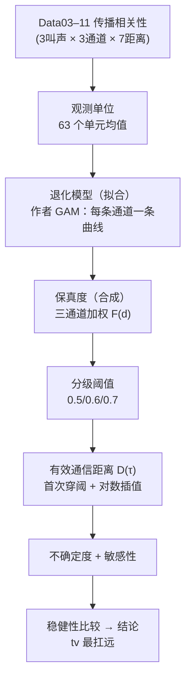
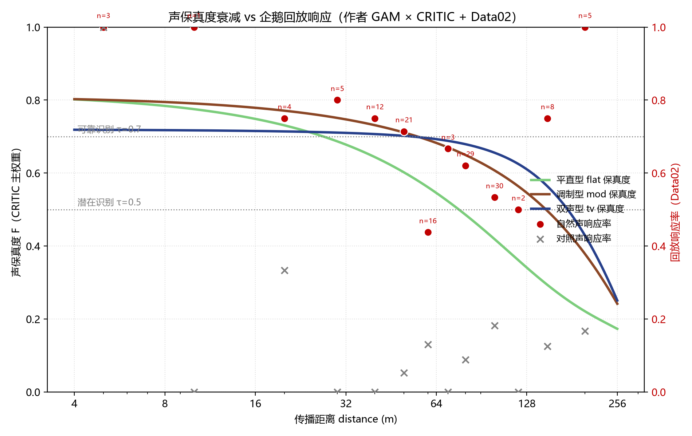
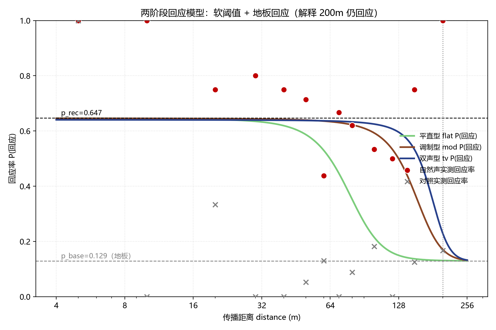
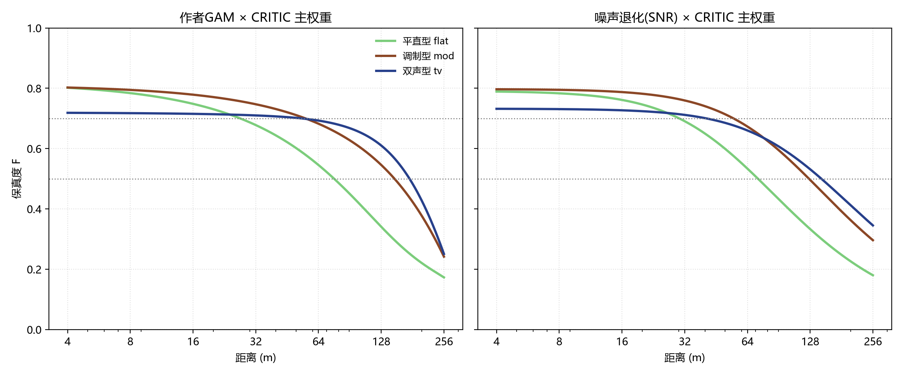
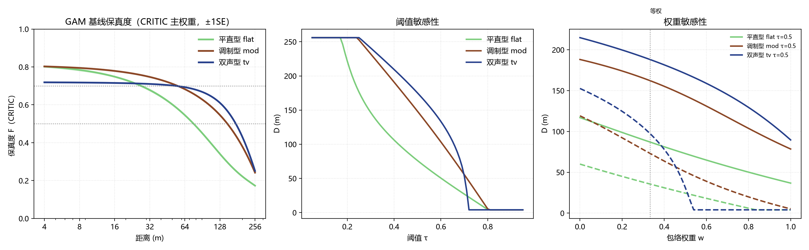

# 问题二 · 建模思路与建模过程

> 声信号的传播衰减与有效通信距离（2026 APMCM Problem C，Question 2）
> 最终方案：**退化模型（拟合）用作者 GAM** + **保真度（合成）用 CRITIC 客观赋权为主权重**，熵权法 / 平均权重为对照。

---

## 一、题目要什么（一句话）

把声谱图、幅度谱、幅度包络三类相关性合成一个随距离衰减的**声保真度** F(d)，设计覆盖「潜在识别 / 识别 / 可靠识别」的**分级阈值**，反解三种叫声的**有效通信距离**，报告不确定度、做敏感性，最后比较**长距离传播稳健性**、判断哪种叫声最适合海上远距离传信息。

## 二、建模思路（总览）

**五个关键决策：**

| 决策点 | 选择 | 理由 |
|---|---|---|
| 观测单位 | 叫声 × 通道 × 距离的**单元均值** | 原始表只有距离列、无样例/录音编号，逐行配对无依据 |
| 退化模型（拟合） | **作者 GAM** 为主，**噪声退化模型(SNR)** 对照 | GAM 对齐 Code2+S4；SNR 由球面扩散+平稳噪声推出 μ=a√(S/(1+S)) |
| **主权重（合成）** | **CRITIC 客观赋权** | 同时考虑指标对比度(σ)与冲突度(1−r)，客观、无先验 |
| 对照权重（合成） | 熵权法、平均权重 | 检验结论对赋权方式的稳健性 |
| 分级阈值 | 0.5 潜在 / 0.6 一般 / 0.7 可靠 | 与第四问扰动值(0.5→0.6→0.7)自洽 |

## 三、建模过程（分步）

### 步骤 1 · 观测单位与数据盘点

9 张相关性表共 18,900 个位置、17,550 有效、范围 0.051–0.995。同类三通道缺失位置一致（逐行对应）。每类每距离有效样本数：

| 类型 | 4m | 8m | 16m | 32m | 64m | 128m | 256m |
|---|---:|---:|---:|---:|---:|---:|---:|
| flat | 300 | 300 | 300 | 290 | 250 | 230 | 290 |
| mod | 300 | 300 | 300 | 300 | 300 | 230 | 300 |
| tv | 300 | 300 | 300 | 270 | 290 | **190** | 210 |

tv 在 128m 只有 190/300 有效，是后面缺缺失敏感性要重点盯的地方。

### 步骤 2 · 多指标保真度（合成，CRITIC 为主权重）

> **先分清两个正交概念**：退化模型（作者 GAM）负责**拟合**——把每条通道的相关性随距离拟成一条曲线；权重负责**合成**——把三条拟合好的通道合成一个 F(d)。**退化模型对所有权重都通用**，权重只在"合成"这一层做比较。

以 21 个「叫声×距离」单元为样本、三条通道为指标，三套权重（声谱图 / 幅度谱 / 包络）：

| 赋权方法 | 声谱图 | 幅度谱 | 包络 | 依据 |
|---|---|---|---|---|
| **CRITIC（主）** | 0.275 | 0.264 | **0.461** | 对比度 σ × 冲突度 (1−r)，包络最独立 → 权重最大 |
| 熵权法 | 0.298 | 0.280 | 0.423 | 信息熵越小(越分散)→权重越大，同样偏包络但略缓 |
| 平均权重 | 0.333 | 0.333 | 0.333 | 无先验，三测度等权 |

合成公式（包络权重 w，频谱两条平分 1−w）：

$$F(d)=(1-w)\,\frac{\mu_{s}+\mu_{a}}{2}+w\,\mu_{e}$$

同时比对了**加权算术平均**与**加权几何平均**：256m 处 tv/mod 排序会翻转（算术 tv 领先、几何 mod 领先），说明"弱通道能否被强通道补偿"是实质问题。

### 步骤 3 · 退化模型（作者 GAM 为主，噪声退化模型对照）

把每条通道的相关性随距离拟合成曲线，两个退化模型：

**① 作者 GAM（主）**：`gam(correlation ~ s(d,k=3), method="REML")`，即 Supplementary 4 原方法——曲线拟合**全部点**、90% 置信带（取自 `gam_predictions.csv`，含 lower90/upper90）。

**② 噪声退化模型（SNR，对照）**：由球面扩散（功率 ∝ 1/d²）+ 平稳背景噪声推出

$$\mu(d)=a\,\sqrt{\frac{S}{1+S}},\quad S=\left(\frac{L}{d}\right)^2\;\Rightarrow\;\mu(d)=\frac{a}{\sqrt{1+(d/L)^2}}$$

声谱图与幅度谱共用一个距离尺度 L，包络单独一个 L，近场上限 a 用有界最小二乘闭式解。

**两者关键差异**：GAM 是非单调的——保留 tv 在 16m 掉到 0.698、32/64m 回升到 0.71/0.75 的**平台**，把 tv 的可靠识别距离拉长；SNR 是强单调的——把这个平台压平，tv 的可靠识别距离提前。这是后面"结论依赖模型"的根源。

### 步骤 4 · 分级阈值方案

| F 范围 | 状态 | 物理对应 |
|---|---|---|
| F < 0.5 | 低于潜在识别 | 信号 ≈ 噪声（SNR≈0.5，−3dB） |
| 0.5 ≤ F < 0.6 | 潜在识别 | 仍有可辨痕迹 |
| 0.6 ≤ F < 0.7 | 一般识别 | — |
| F ≥ 0.7 | 可靠识别 | 信号 ≈ 2×噪声（SNR≈2，+3dB） |

重点两条判据：**τ潜在=0.5，τ可靠=0.7**。阈值为操作性值（未经企鹅听觉试验校准），用 Data02 验证过：自然声响应 64.7% vs 对照 12.9%（识别确实发生），企鹅最远 200m 仍在响应（行为下界 ≥200m，声学估计保守自洽）。

> 红线=三种叫声的保真度曲线（左轴），红点=自然声响应率（右轴，标 n 为样本数），灰×=对照响应率。保真度随距离单调下降，但响应率**不**随距离单调下降（60m 掉到 44%、200m 又回到 100%），说明**响应 ≠ 识别**——行为响应无法干净标定识别阈值，只能作行为下界验证。

### 步骤 4.5 · 两阶段回应模型（解释"阈值之下仍有回应"）

保留硬阈值方案不动，在阈值下游接一个"带地板的链式"回应模型：

$$P(\text{回应})=P(\text{识别}\mid F)\cdot p_{rec}+(1-P(\text{识别}\mid F))\cdot p_{base}$$

$$P(\text{识别}\mid F)=\frac{1}{1+e^{-k(F-\tau)}}\quad\text{(sigmoid 软阈值)}$$

参数：τ=0.5（潜在识别中点）、k=20（软阈值陡度）、p_rec=0.647（识别后回应率=自然声实测）、p_base=0.129（未识别基线回应率=对照实测）。

**关键**：F 低于 τ 时 P(识别)→0，但第二项给出 ≈0.129 的**地板回应**——数值上自然解释"200m（F≈0.22–0.43 略低于 0.5）仍有回应"，无需改任何阈值。

| 距离 | 叫声 | F | P(识别\|F) | P(回应) |
|---|---|---|---|---|
| 100 m | flat / mod / tv | 0.419 / 0.607 / 0.656 | 0.165 / 0.895 / 0.958 | 0.214 / 0.593 / 0.625 |
| 200 m | flat / mod / tv | 0.221 / 0.378 / 0.428 | 0.004 / 0.080 / 0.193 | 0.131 / 0.171 / 0.229 |

### 步骤 5 · 有效通信距离 D(τ)（作者 GAM 拟合 × 三套权重合成）

| 权重 | 叫声 | D(0.5) 潜在 | D(0.6) | D(0.7) 可靠 |
|---|---|---|---|---|
| **CRITIC（主）** | flat | 76.1 m | 50.4 m | 27.0 m |
| | mod | 148.3 m | 103.3 m | **55.5 m** |
| | tv | **175.1 m** | **133.3 m** | 53.4 m |
| 熵权法 | flat | 79.3 m | 53.2 m | 29.5 m |
| | mod | 152.6 m | 108.5 m | 60.5 m |
| | tv | **179.1 m** | **139.1 m** | **69.9 m** |
| 平均权重 | flat | 86.9 m | 59.9 m | 35.5 m |
| | mod | 162.1 m | 120.5 m | 73.0 m |
| | tv | **188.0 m** | **151.4 m** | **97.2 m** |

**噪声退化模型（SNR）对照：**

| 权重 | 叫声 | D(0.5) 潜在 | D(0.6) | D(0.7) 可靠 |
|---|---|---|---|---|
| **CRITIC（主）** | flat | 71.9 m | 49.9 m | 30.2 m |
| | mod | 126.4 m | 88.6 m | **54.9 m** |
| | tv | **144.9 m** | **93.9 m** | 40.8 m |
| 熵权法 | flat | 74.7 m | 52.3 m | 32.5 m |
| | mod | 129.8 m | 91.7 m | **57.9 m** |
| | tv | **150.7 m** | **99.1 m** | 47.5 m |
| 平均权重 | flat | 81.1 m | 57.8 m | 37.8 m |
| | mod | 138.0 m | 98.8 m | **64.9 m** |
| | tv | **164.1 m** | **111.4 m** | 61.7 m |

**两模型对比的关键差异**：可靠识别(0.7)下，GAM 里 tv 在熵权/平均权重下领先、只有 CRITIC 下被 mod 微幅反超；而 SNR（强单调）压平了 tv 的 32–64m 平台，导致**所有权重下 mod 都在 0.7 反超 tv**。这说明"tv vs mod 谁更可靠"既依赖权重、也依赖退化模型选择。

### 步骤 6 · 不确定度与敏感性

- **采样标准误（±1SE）**　CRITIC 主权重下，平直型在 0.5 判据下的有效距离为 76.1 m，近似范围为 75.2–77.0 m。三种声型的两项判据见[论文报告范围修正](论文报告范围修正.md)。
- **缺缺失压力测试**：若缺失样本弱到接近 0，tv 的 D(0.5) 从 145m 崩到 90m、mod 反超 → "tv 传最远"依赖缺失样本非系统性偏弱；
- **阈值敏感性**：D(τ) 随 τ 连续下降；
- **权重敏感性**：τ=0.5 下 tv 全区间领先；τ=0.7 下 **tv/mod 在包络权重 w≈0.45 翻转**——CRITIC(0.461) 刚跨到 mod 侧、熵权(0.423) 和等权(0.333) 在 tv 侧。

### 步骤 7 · 稳健性比较（最终结论）

| 判据 | 排序（CRITIC 主权重） | 说明 |
|---|---|---|
| 潜在识别 (0.5) | **tv > mod > flat** | tv 175m，且对权重稳健（翻转点 w≈0.78） |
| 可靠识别 (0.7) | **mod ≈ tv**（55.5 vs 53.4） | 差 2.1m，在不确定度内；权重敏感（翻转点 w≈0.45） |
| 远距离残余质量 (128–256m) | **tv > mod > flat** | tv 频谱衰减最慢 |

## 四、最终结论

**三种叫声在长距离传播中的稳健性：tv（双声型）> mod（调制型）> flat（平直型）。最适合海上远距离传信息的是双声型 tv。**

- **为什么 tv 最扛远**：声谱图 + 幅度谱等效尺度 ~155m（flat 仅 69m），双套谐波的**频谱冗余**让频谱结构在长距离保留最久；
- **为什么 flat 最差**：峰频高（~979Hz）、频谱尺度最短，衰减最快；
- **CRITIC 主权重下的限定**：tv 在潜在识别(0.5)下稳定领先（175m）；可靠识别(0.7)下 mod 仅以 2.1m 微弱领先（55.5 vs 53.4），二者基本打平——因为 CRITIC 把 0.46 权重给了包络，而 tv 包络最弱；
- **对照组一致性的意义**：熵权法和平均权重都给出 tv 全面领先，说明"tv 最扛远"的结论对赋权方式稳健；只有 CRITIC 在可靠识别阈值下让 mod 微幅反超。

## 五、产出文件索引

| 文件/文件夹 | 内容 |
|---|---|
| `gam_baseline/` | **最终方案**：作者 GAM 基线 × CRITIC 主权重 + 熵权/等权对照 |
| `critic_fidelity/` | CRITIC 赋权 + SNR 退化曲线 + 三次样条对比 |
| `effective_range/` | SNR 模型的有效距离 + 删距不确定度 + 敏感性 |
| `fidelity_measure.py` | 第一版 0.5/0.3/0.2 加权保真度 |
| `step1_geometric.py` | 几何平均对照 |
| `results/` | 第一版保真度结果（CSV + 图） |

> 复现：`pip install numpy pandas scipy matplotlib` 后运行各文件夹内 `*.py`。GAM 基线依赖团队已运行的 `gam_predictions.csv`（R+mgcv 产物）。
