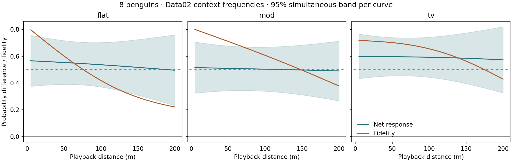

# 第四问　非洲企鹅海面叫声的通信有效性

以 8 只企鹅为典型群体，按实验中的三种情境加权，双声型叫声在潜在识别阈值 0.5 下的模型半径为 175 m。联合检查距离与群体规模后，双声型在三种情境及各自对照中共同可插值的区间为 44–110 m，整个区间都满足判据。175 m 依赖部分情境的外推。调制型在搜索情境仅测到 1–4 只，针对 8 只的综合结果包含群体规模外推。

## 数据、公式与程序顺序

1. **确定实验单位。** 赛题第 4 页要求整合前序模型。Data02 共 278 条回放，139 个 expID 各含一次自然声和一次控制声。Supplementary 1 给出同批 139 个群体的规模分布。自然声组规模的四分位点为 3、8、15。两次回放中有 90 对改变了距离、2 对改变了群体规模，情境均相同。用相同预测条件比较两种声音，抽样单位取完整实验。数据中没有可跨实验追踪的个体标识。
2. **选择声学输入。** 第一问提供 flat、mod、tv 的类别；Data02 已有播放标签。Data03–11 的三个相关性通道依次为声谱图、幅度谱和幅度包络。Supplementary 4 的参考条件为海面上方、以 1 m 录音为参照、测量距离 4–256 m。读取第二问全数据 GAM 曲线（hold=0），按定稿的统一 CRITIC 权重 0.275187、0.263609、0.461204 合成 $F_k(d)=\sum_m w_m f_{km}(d)$。代码从原始表独立核算权重，并核对第二问九个穿阈距离。权重描述三个声学指标的信息贡献。
3. **重建行为概率。** 复用第三问 models.py 的全交互 Logistic 门控和七类岭多项 Logistic，固定第三问选定的模型结构和惩罚。编码按 H（抬头）、V（鸣叫）、A（靠近声源）分别占 4、2、1 编码。设 $p$ 为出现任一目标行为的概率，$q_j$ 为发生行为后的条件构成，则 $\pi_0=1-p$、$\pi_j=pq_j$。Supplementary 3 给出原研究按行为的模型，第四问需要的联合概率来自第三问八类互斥组合。
4. **计算指数。** $EI=P(V\cup A)=P_V+P_A-P_{VA}$。每个包含 V 或 A 的试次计一次。H 单独发生时只说明警戒或注意。V 可反映声学联系，A 记录朝设备靠近的行为；该实验无法直接证明后续群体形成或觅食收益。该定义无需指定两种行为的相对生态价值。
5. **同条件比较。** $\Delta EI=EI_k-EI_{control}$。在 5–200 m 按 1 m 步长预测，分别固定群体规模和情境。标准化情境权重取同一批配对实验中的 after 36/139、commuting 65/139、searching 38/139。该分布代表试验样本。每次重抽样均先在样本内计算差值与加权平均，再汇总不确定性。
6. **寻找半径。** 从所选范围的最近距离向外，要求每一个网格点同时满足 $F_k(d)\ge T$ 和 $L_k(d)>0$，记录首次失效前的最后一个网格点。$L_k$ 是每条净效应曲线跨距离的近似 95% 同时带下界。按 expID 重抽样 499 次并重新拟合，种子 20261127。每条曲线以 Bootstrap 最大绝对标准化偏差的 95% 分位数乘逐点标准误确定带宽。覆盖范围限于单条曲线；跨叫声、情境和群体规模的全部比较没有统一校正。

## 行为与半径

自然声下 80/139 次至少出现鸣叫或靠近，控制声下为 5/139 次。下表在 100 m、8 只且使用同一情境分布时比较。ΔEI 的区间为配对 Bootstrap 逐点 95% 百分位区间。

| 播放声 | 鸣叫概率 | 靠近概率 | 两者同时 | 至少一种 EI | ΔEI（95% 区间） |
|---|---:|---:|---:|---:|---:|
| 控制声 | .049 | .008 | .006 | .051 | 基线 |
| flat | .569 | .097 | .079 | .588 | .537 [.395, .664] |
| mod | .529 | .194 | .168 | .555 | .504 [.369, .627] |
| tv | .619 | .165 | .141 | .644 | .593 [.457, .698] |

100 m 处，flat 的净行为效应仍为正，但声学保真度已降至 0.419，低于 0.5。只凭回放后出现行为，会得到比联合判据更远的距离。

| 叫声 | 模型半径 T=.5 / .6 / .7（m） | 三种情境及对照的距离与规模联合覆盖（8 只） |
|---|---|---|
| flat | 76 / 50 / 26 | 共同覆盖 76–91 m。阈值 .5 仅 76 m 达标，.6 和 .7 均在区间起点失效 |
| mod | 148 / 103 / 55 | 搜索情境缺少 8 只群体，三情境标准化结果依赖外推 |
| tv | 175 / 133 / 53 | 共同覆盖 44–110 m。阈值 .5 和 .6 到 110 m 仍成立，阈值 .7 到 53 m |

程序在每个声音和情境内，用实际记录的“距离、群体规模”点构成凸包，取固定规模的水平截面，再对自然声、控制声和参与汇总的情境求交集，输出为 `joint_hull`。凸包内部可插值，局部仍可能缺少相邻观测。`cell_ranges` 为分别检查距离和规模后的边际范围，供与旧结果对照。例如 100 m、8 只的三情境预测中，只有 tv 落在严格共同覆盖内。`pooled_distance` 为全样本的 5–200 m 网格。

模型半径使用全样本距离范围，自 5 m 起算，均由声学条件首先截断。限定范围结果从各叫声与控制声在相应情境的共同起点计算，无法据此验证更近的区段。即使距离、规模分别位于观测范围内，也可能是稀疏的组合。在 .7 阈值处将保真度上下平移一个第二问标准误，mod 的半径为 54–56 m、tv 为 49–56 m，两者的次序对声学误差敏感。这些是误差扰动范围；第二问未提供联合曲线的 Bootstrap 抽样，通道间误差协方差和录音间系统差异尚未传播。



图取 8 只、经验情境权重。蓝色为 ΔEI 和跨距离带，棕色为保真度，棕色虚线标出 0.5。图横轴为全样本范围，分层覆盖限制见上表。

结果表中的 `standardized` 使用 Data02 的实验情境比例，`equal_weight` 使用三种情境各 1/3。两套目标权重在 499 次配对重抽样中保持固定，每次都先汇总当次的分情境预测，再分别构造同时带、判定半径。按两套权重逐项比较 1,215 组条件（3 类叫声 × 3 种规模 × 3 档阈值 × 5 档损失 × 3 种距离范围 × 3 档声学误差扰动），半径及首次限制原因全部一致。下文列出了行为净增幅随权重改变的数值。

## 情境、群体规模与环境情景

- **情境。** tv 在 100 m、8 只时，after、commuting、searching 的 ΔEI 为 .330、.641、.759。若给三种情境相同权重，flat、mod、tv 的 ΔEI 分别为 .562、.542、.577，经验权重下为 .537、.504、.593。情境构成会改变总体估计。
- **规模。** tv 在 100 m 的标准化 ΔEI 随规模 3、8、15 分别为 .624、.593、.539。15 只超出搜索情境的观测规模。数据记录群体是否发生行为，个体参与情况只能作情景估计。令 $\rho$ 为群体发生该行为时平均参与比例，则 $E[M_V]=N\rho P_V$，靠近同理。对 tv、8 只、100 m，假定平均一半参与，预计鸣叫 2.48 只、靠近 0.66 只；两者可能重合。结果表还列出恰一只参与和全群参与的边界。
- **声学扰动。** 令 $F'=(1-\delta)F$。δ 取 0、5%、10%、15%、20%。在 T=.5 时，三类叫声从基线的 76、148、175 m，分别缩至 20% 扰动下的 44、91、119 m。在 T=.7 且损失 20% 时，三类均在 5 m 起点失效，按连续判据未识别到有效区间。阈值仅是评价标准，单独提高阈值不改变同一距离下的行为模型输出。
- **响应概率的条件性估计。** Data02 没有同步噪声暴露梯度，第三问距离模型无法单独识别噪声引起的行为变化。环境表同时保留原 EI，另用第二问软阈值 $s(f)=\mathrm{logit}^{-1}(20(f-0.5))$ 做显式情景推演。假设背景响应稳定、自然声相对背景的增量按识别概率比例衰减，则 $EI'=EI_{control}+[s(F')/s(F)]\Delta EI$。它在零损失时返回原估计。100 m、8 只时，20% 损失对应 flat、mod、tv 的 EI 从 .588、.555、.644 变为 .167、.293、.435。结果取决于斜率和衰减假设，缺少暴露试验校准。δ 不能直接换算为船噪分贝、航速或风浪等级。

## 验证与保护含义

对 3 种情境、4 种播放声、3 个代表距离的八类概率，重算与第三问输出的最大绝对差为 $4.97\times10^{-11}$ 以下。程序检查了概率归一、联合事件恒等式和同一 expID 的折归属。沿用第三问嵌套五折的训练结构，第四问联合事件的折外 Brier 分数为 .127。五个等频预测组的平均预测率为 .020、.055、.182、.473、.768，观测率为 .018、.055、.196、.491、.768。原数据中单独靠近仅 1 次、抬头加靠近 3 次，各稀有类别的拟合依赖收缩；控制声仅一条音轨。

在实测确认的活跃觅食区和高船流时段，可先试行船只绕避聚集群体、减少反复接近和怠速停留，并比较实施前后和同期对照海域的背景声谱、群体鸣叫及定向靠近率。声学结果适合选择监测距离梯度；设置船只管制边界还需要当地航道、风浪、船型噪声和活动海域资料。后续试验宜增加多种控制音轨，随机化播放顺序，记录接收位置的声级与频谱，补充搜索情境中较大群体及 150–200 m 观测；用同步视频标记每只个体参与哪种行为，才可直接估计参与比例和重叠人数。

## 复现与结果文件

在本机的工作区根目录运行以下 PowerShell 命令。脚本按自身位置寻找前三问项目，结果写入本目录的 results。使用 D 盘独立 Python 3.13 环境（NumPy 2.3.2、pandas 2.3.1、SciPy 1.16.1、matplotlib 3.10.5）。

```powershell
& 'D:/Python/python.exe' -B -X utf8 '2026APMCM/problem4/run_q4.py'
```

| 文件 | 用法 |
|---|---|
| results/behavior.csv | 八类无条件概率、P_V、P_A、P_VA、P_H 和 EI |
| results/effects.csv | 配对净效应、逐点区间、跨距离下界、保真度和分层支持标记 |
| results/radius.csv | 按阈值、环境损失、群体规模、情境、支持范围和声学误差扰动列出联合半径；空值按 first_limit 区分起点失效与缺乏覆盖 |
| results/bootstrap_radius.csv | 固定声学曲线，以每次重抽样的正净效应求边界；列出有效区间非空比例，以及非空时的边界分位数。主半径使用同时带下界，两种统计量含义不同 |
| results/environment.csv | 50、100、150 m 的降质后保真度、通过阈值情况、原行为概率和识别衰减假设下的概率 |
| results/participant_scenarios.csv | 三种个体参与假设下的两类期望人数 |
| results/held_out_EI.csv、results/calibration.csv | 每次回放的折外预测和五组校准汇总 |
